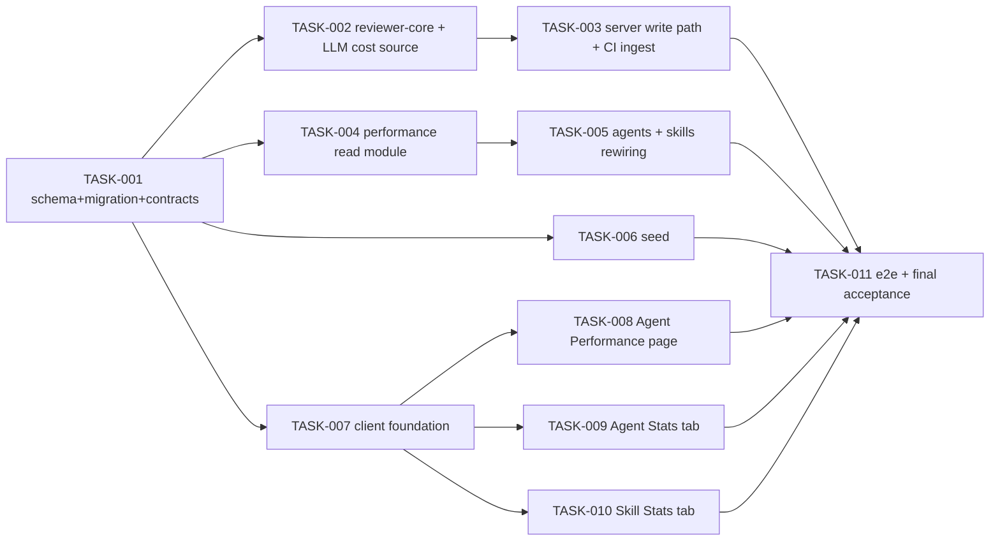

# Plan: Agent Performance dashboard + Agent Stats + Skill Stats

> Status: DRAFT
> Created: 2026-10-11
> Spec: `specs/SPEC-2026-10-11-agent-performance-dashboard.md` (83 EARS ACs) is the source of truth. Background: `~/.claude/plans/proud-beaming-lake.md`; the spec wins on any conflict.
> Execution Mode: **multi-agent** (phased; parallel tasks inside a phase have disjoint owned paths). One branch `feat/agent-performance-dashboard`, one PR.
> Spec corrections applied by this plan (user-approved, may not yet be in the spec file):
> - (a) AC-25: Most-active agent is chosen among **existing** agents only; the "Deleted agents" aggregate is never eligible.
> - (b) AC-82: seed creates **no `running`** runs (only `cancelled`); exclusion of `running` is proven by integration tests.
> - (c) AC-77/78: in top-K mode entries **without an embedding are not eligible**; fallback only when the embedder is unavailable/fails or no eligible entry has an embedding; seed gives every memory entry an embedding.
> - (d) AC-3: a stored period that is malformed, or a custom range > 30 days → falls back to 30 days; a valid **past** custom range is kept.

---

## Requirements (VRF)

> Status: Confirmed. The spec is approved; no product questions are reopened. Implementation ambiguities are listed in "Open Questions & Recommendations" with defaults that implementers MUST follow.

| ID | Requirement (implementation terms) | Source |
|----|-----------------------------------|--------|
| R1 | Sidebar GLOBAL order Memory → Multi-Agent Review → Agent Performance → CI Runs; new item links to workspace route `/agent-performance`. | AC-1 |
| R2 | One global period (`1d` / `30d` / custom ≤ 30 days) held in a `PeriodProvider` (localStorage `dd-period`), the same `PeriodSelect` on 3 screens, default 30d, invalid/malformed/>30-day stored value → 30d, valid past custom kept. | AC-2, AC-3, AC-6, corr. (d) |
| R3 | One server function `resolveWindow` turns (preset or from/to, IANA tz, now) into `{from,to,buckets,previous}`; bucket rules H1…H6 / D1…Dn / W1…W5; `[start,end)`; empty buckets zero-filled; previous window = same nominal length ending at `from`. Invalid input → **HTTP 400**. | AC-4…AC-9, AC-12 |
| R4 | Bucket tooltips show the exact local range and "in progress"/"partial"; no period suffix anywhere; window caption next to the selector. | AC-10, AC-11 |
| R5 | All stats endpoints are GET-only and DB-only (no LLM / embedder / review / CI import); the client issues only GETs except the explicit "Sync CI". | AC-13, AC-14 |
| R6 | One shared per-agent aggregation (runs, cost sum, runs w/o cost, avg cost, avg duration over successful runs, accepted/resolved over local findings, last run, cost-source mix) used by dashboard rows, Agent Stats KPIs and the all-time Agents list. Only finished runs count; `running`/`cancelled` are excluded everywhere. Finding → window by run time, fallback review agent + `created_at`. | AC-15…AC-21, AC-72 |
| R7 | Cost-source badge billed/estimated/mixed, computed only over runs with a recorded source; no badge if there are none. | AC-22, AC-73, AC-80 |
| R8 | Dashboard KPIs: runs + sparkline; total cost + badge + "N runs without cost" + a delta only with full-history coverage; Σaccepted/Σresolved; most-active agent with tie rules over existing agents. | AC-23…AC-26, corr. (a) |
| R9 | Agent table: every workspace agent + optional "Deleted agents" row; Runs/Avg cost/Avg dur/Accept/Last run/View; colour, arrows, client-only sort with small-sample rules; expand from response data; deterministic palette colour + `Cpu`. | AC-27…AC-35 |
| R10 | Cost donuts by agent / by model, Σ equal to Total cost, ≤ 7 segments with "Other (N …)", "$" with 2 decimals, centre total, badge, grey ring when there is no cost. | AC-36…AC-40 |
| R11 | Agent Editor Stats tab: KPIs (+ avg-cost delta rule), Most-used skills, Most-pulled memory (with "No data before"), severity StackedBar per bucket incl. CI findings, 5-category donut, run history (cursor pages, limit ≤ 50, infinite scroll), shared RunTraceDrawer + `GET /runs/:id/findings`, GitHub link for CI rows. | AC-41…AC-53 |
| R12 | Skill Stats tab rewritten: Used by (+ "N ran in period"), Pull frequency (local, PR-based), Accept rate & Findings over `rule_refs`-attributed findings, category donut, agents list with Open, empty states; old formulas removed. | AC-54…AC-59, AC-71 |
| R13 | Loading = skeletons without numbers; error = ErrorState + Retry of only the failed GET; three distinguishable empty states; empty states are text only. | AC-60…AC-65 |
| R14 | Sync CI button (only when the workspace has a CI installation) → existing `POST /ci-runs/refresh`, disabled while running, invalidates stats queries, toast "Imported N CI runs", error toast keeps data. | AC-66, AC-67 |
| R15 | CI ingest: agent run `ran_at` = CI run time, `ci_run_id` set; CI findings count in severity/category, never in accept; CI rows without a model → "Unknown model", "—" tokens, no badge contribution. | AC-68…AC-70 |
| R16 | Write path: `cost_source`, `[S1]…[Sn]` skill labels, response fields `skills_applied` / `rule_refs`, label→id mapping, `agent_run_skills`, top-K memory with fallback + `memory_mode` + `agent_run_memory`, reviewer-core invariants kept. | AC-73…AC-79, corr. (c) |
| R17 | Exactly one generated migration, no backfill and no deletion, seed per AC-82 (no running runs), no Settings changes. | AC-80…AC-83, corr. (b) |

---

## Open Questions & Recommendations

The defaults below are binding for implementers unless the user overrides them.

| # | Question | Default (follow this) | Type |
|---|----------|-----------------------|------|
| Q1 | CI-ingested `agent_runs` use statuses `succeeded` / `failed` / `no_findings`, not `done`. AC-15 says "status done or failed … including CI runs". | Define in `server/src/modules/performance/constants.ts`: `COUNTED_STATUSES = ['done','failed','succeeded','no_findings']`, `SUCCESS_STATUSES = ['done','succeeded','no_findings']`. "done" in the spec means any SUCCESS status. `running`, `cancelled` and `null` never count. No data rewrite. | gap |
| Q2 | Zod validation errors map to **422** in `app.ts`; AC-7 / AC-52 require **400**. | Add `BadRequestError` (status 400, code `bad_request`) to `server/src/platform/errors.ts`. The `app.ts` error mapper maps any `AppError` by `statusCode`; verify this. Route `querystring` schemas are permissive (`z.object({...all optional z.string()})`). Strict parsing happens in `parseStatsQuery()`, which throws `BadRequestError`. A tampered cursor, bad tz, bad range or limit > 50 → 400. | 🚩 red flag |
| Q3 | "≤ 30 days" across a DST change (a 30-local-day custom range can be 30×24h ± 1h). | Validate as `to ≤ addLocalDays(from, 30, tz)` (wall-clock +30 days in tz). `30 days + 1 minute` still → 400. | gap |
| Q4 | A custom `to` is "capped at now WHEN D2 is today", but the client cannot keep a stable query key if it caps `to` itself. | The client always sends `from = D1 00:00 local` and `to = (D2+1) 00:00 local` as ISO with offset. The server caps `to = min(to, now)`; `from ≥ now` → 400. The bucket type comes from the **uncapped** local day count (1 → H, 2–14 → D, 15–30 → W). For a 1-day custom range the 6 slots are 00–04 … 20–24 of D1. Slots that lie fully after `now` are returned with zeros; the slot containing `now` is `partial: true`. Previous-window length = nominal length (1d preset → 24 h, 30d → 30×24 h, custom → N local days). | gap |
| Q5 | Top-K edge case: 0 eligible entries vs "no eligible entry has an embedding". | Order: (1) load eligible entries (scope + confidence ≥ 0.7); (2) 0 eligible → mode `top_k`, 0 records, **no embed call**; (3) none of the eligible has an embedding → `fallback`; (4) `container.embedder()` throws or `embed()` fails → `fallback`; (5) otherwise rank eligible-with-embedding by cosine similarity and take 5 → `top_k`. Fallback = today's `selectForPrompt` result, records with `similarity = null`, rank = list order. | gap |
| Q6 | When are usage records written for failed runs? | `memory_mode` + `agent_run_memory` are written right after selection, so failed runs that pulled memory count in the memory denominator. `agent_run_skills` rows are written only when a review response was saved (status `done`); failed runs get no skill records ("only runs for which skill usage was recorded count", AC-44). | gap |
| Q7 | Map-reduce runs have several chunks, possibly with different cost provenance. | The run's `costSource` is `'api'` only if every chunk reported a provider cost; otherwise `'estimate'` if total `costUsd != null`; otherwise `null`. `skills_applied` = union over chunks; `null` only if **all** chunks omitted it. | gap |
| Q8 | `CiService.ingestAll` inserts a new `agent_runs` row on every re-ingest; the duplicates inflate Runs. | Now that `ci_run_id` exists, skip the insert when an agent run with that `ci_run_id` already exists (repo method `findAgentRunIdByCiRunId`). Old duplicates are left untouched (AC-80: no deletion). | 🚩 red flag |
| Q9 | `ci_runs.ran_at` is currently set to ingest time and overwritten on upsert; AC-68 needs the real CI time. | Use the GitHub workflow run's `run_started_at ?? created_at` from the VCS listing; fall back to ingest time only if neither field exists. On upsert conflict, do not overwrite `ran_at` with a newer ingest time. | gap |
| Q10 | AC-71 removes the old skill formulas, but `SkillsRepository.listWithStats` (skills list page) uses the same verdict-based formulas. | TASK-004 provides `performanceRepo.skillAggregatesAllTime(ws)` (one batched query, new definitions, no window). TASK-005 makes the list use it and deletes the old SQL. Keep the list-view field names (`pull_frequency_pct`, `accept_rate_pct`); update the `skills-stats.it.test.ts` AC-018 comparison to match. | gap |
| Q11 | No workspace-level "has CI installations" endpoint exists (only `GET /agents/:id/ci-installations`). | Add `hasCiInstallations: boolean` to the `GET /agent-performance` and `GET /agents/:id/stats` responses (a read-only query on `ci_installations ⋈ agents.workspace_id`). | 💡 recommendation |
| Q12 | Context docs are merged near the skills in `run-executor.ts:331-340`. Are they in the `skills` array passed to `assemblePrompt`? | The implementer verifies this. Labels `[S1]…[Sn]` go only on agent skills. If context docs share the array, put the skills first and pass the count via a new optional `PromptParts.skillLabelCount?: number` (labels only the first N entries); the server maps labels only for those N. | gap |
| Q13 | The shared contracts exist in **two copies**: `server/src/vendor/shared` (used by the server and reviewer-core) and `client/src/vendor/shared` (the client alias). | TASK-001 mirrors every contract change into both copies (server style: double quotes + `.js` suffix; client style: single quotes, no suffix). | 🚩 red flag |
| Q14 | StackedBar: Recharts `ResponsiveContainer` renders 0 width in jsdom, which makes bars untestable. | Implement `StackedBar` as flex `div` columns (like the mockup `StackedSeverityBar`) with a hover tooltip state; no Recharts. Donut stays on Recharts. | 💡 recommendation |
| Q15 | How many bars do Most-used skills / Most-pulled memory show? | Skills: every skill with records in the window, sorted by % desc. Memory: the top `MEMORY_BARS_MAX = 8` by % desc (constant). Preview = first 80 chars of `memory.content`. | gap |
| Q16 | Where does the PR link in run history point? | Contract `pr: { number, repoId: string \| null, githubUrl: string \| null } \| null`. Local rows → in-app `/repos/{repoId}/pulls/{number}`. CI rows → `https://github.com/{ci_installations.repo}/pull/{ci_runs.pr_number}`. Old CI rows (no `ci_run_id`) → `null` ("—"). | gap |
| Q17 | `client/messages/en/agentPerformance.json` already exists and is unused (a leftover). | Replace its content with the new keys (no dead keys). | 💡 recommendation |
| Q18 | `observability.ts` contains unused stubs `AgentStats` / `StatPoint`, and the `AgentStats` name clashes. | Delete them in both contract copies (grep first: they must have no importers). The new types live in `contracts/performance.ts`. | 💡 recommendation |
| Q19 | `seed(db)` is also called by integration tests, so demo runs would change their counts. | Demo data goes into a new `seedPerformanceDemo(db, ids)` that is called only from the CLI entry of `seed.ts` (`pnpm db:seed`), not from the exported `seed(db)`. | 🚩 red flag |
| Q20 | What about a review whose `run_id` points to a missing run, or to a `running`/`cancelled` run? | Missing run → treat as "no run link" (fallback to review agent + `created_at`). Linked run with a status that does not count → its findings are excluded (AC-15). A review agent id that no longer exists → "Deleted agents" group. | gap |

---

## Affected Modules

| Module | Path | Change Type |
|--------|------|-------------|
| DB schema + migration | `server/src/db/schema/{runs,reviews}.ts`, `server/src/db/migrations/0028_*` | Modify / Add |
| Shared contracts (2 copies) | `server/src/vendor/shared/`, `client/src/vendor/shared/` | Add / Modify |
| reviewer-core | `reviewer-core/src/{prompt.ts,review/run.ts,review/reduce.ts,llm/openrouter.ts}`, tests, docs | Modify |
| backend: LLM adapters | `server/src/adapters/llm/{openai,anthropic}.ts` | Modify |
| backend: `reviews` write path | `server/src/modules/reviews/run-executor.ts`, `repository/*.ts`, new helpers | Modify / Add |
| backend: `memory` | `server/src/modules/memory/repository.ts` | Modify |
| backend: `ci` | `server/src/modules/ci/{service,repository}.ts`, GitHub VCS adapter | Modify |
| backend: `performance` (new) | `server/src/modules/performance/` | Add |
| backend: `agents`, `skills` | `server/src/modules/{agents,skills}/` | Modify |
| platform | `server/src/platform/{container,errors}.ts`, `server/src/modules/index.ts` | Modify |
| seed | `server/src/db/seed.ts`, new `server/src/db/seed-performance.ts` | Modify / Add |
| frontend: UI kit + nav | `client/src/vendor/ui/{nav.ts,charts/}` | Modify / Add |
| frontend: shared stats + period | `client/src/lib/{contexts,utils,hooks,api.ts}`, `client/src/components/{stats,run-trace-drawer}/` | Add / Modify |
| frontend: pages | `client/src/app/agent-performance/`, `client/src/app/agents/[id]/`, `client/src/app/skills/[id]/.../StatsTab/` | Add / Modify |
| e2e | `e2e/specs/`, `e2e/docs/flows.md` | Add |

---

## Dependency graph

---

## Tasks

### TASK-001: DB schema, the single migration, shared contracts (both copies)

**Scope:** both (contracts). Runs FIRST, alone.
**Depends on:** —

**Owned Paths:**
- `server/src/db/schema/runs.ts`
- `server/src/db/schema/reviews.ts`
- `server/src/db/schema.ts` (barrel; only if the new tables need an explicit export)
- `server/src/db/migrations/0028_*.sql`, `server/src/db/migrations/meta/_journal.json`, `server/src/db/migrations/meta/0028_snapshot.json`
- `server/src/vendor/shared/contracts/performance.ts` (new), `server/src/vendor/shared/contracts/findings.ts`, `server/src/vendor/shared/contracts/observability.ts`, `server/src/vendor/shared/adapters.ts`, `server/src/vendor/shared/index.ts`
- `client/src/vendor/shared/contracts/performance.ts` (new), `client/src/vendor/shared/contracts/findings.ts`, `client/src/vendor/shared/contracts/observability.ts`, `client/src/vendor/shared/adapters.ts` (if present), `client/src/vendor/shared/index.ts`

**What to do:**
1. In `schema/runs.ts`, add to table `agentRuns` (lines ~8-34):
   - `costSource: text('cost_source', { enum: ['api','estimate'] })`, nullable.
   - `memoryMode: text('memory_mode', { enum: ['top_k','fallback'] })`, nullable.
   - `ciRunId: uuid('ci_run_id').references(() => ciRuns.id, { onDelete: 'set null' })`, nullable. Import `ciRuns` from `./ci`, check for an import cycle, and use the lazy `() =>` form.
   - Indexes `agent_runs_ws_ran_at_idx (workspace_id, ran_at)` and `agent_runs_agent_ran_at_idx (agent_id, ran_at)`.
2. Add two new tables to the same file:
   - `agentRunSkills` (`agent_run_skills`): `runId` uuid notNull → `agentRuns.id` cascade; `skillId` uuid notNull → `skills.id` cascade; `skillVersion` integer notNull; `applied` boolean notNull; `findingsCited` integer notNull default 0; PK `(run_id, skill_id)`.
   - `agentRunMemory` (`agent_run_memory`): `runId` → agentRuns cascade; `memoryId` → `memory.id` (from `./knowledge`) cascade; `rank` integer notNull; `similarity` doublePrecision nullable; PK `(run_id, memory_id)`.
3. In `schema/reviews.ts`:
   - `findings`: add `ruleRefs: uuid('rule_refs').array()`, nullable.
   - `reviews`: add index `reviews_run_id_idx (run_id)`.
4. Run `cd server && pnpm db:generate` **once**. This yields exactly one new migration `0028_*.sql` plus its snapshot.
   - Read the SQL: it may contain only ADD COLUMN / CREATE TABLE / CREATE INDEX — no DROP/UPDATE/TRUNCATE.
   - Then run `pnpm db:migrate` locally.
   - **No other task may change schema files** (AC-81).
5. In `contracts/findings.ts`:
   - `Finding` (line ~53): add `rule_refs: z.array(z.string()).max(20).optional()`. In LLM output these are labels (`"S1"`).
   - `FindingRecord` (line ~78): override with `rule_refs: z.array(z.string().uuid()).nullish()`. These are the persisted skill ids.
   - The review output schema used by reviewer-core (`Review`, imported in `reviewer-core/src/review/run.ts:9`; find its file): add `skills_applied: z.array(z.string()).max(50).optional()`.
6. In `adapters.ts`:
   - `StructuredResult<T>` (line ~73): add `costSource?: 'api' | 'estimate' | null`. It is optional so existing mocks still compile.
   - If the VCS workflow-run listing type used by `CiService.ingestAll` lacks a start time, add optional `run_started_at?: string | null` and `created_at?: string | null` (see Q9).
7. Create `contracts/performance.ts` and export it from `index.ts`. Exact names:
   - **Query and enums:**
     - `StatsQuery` = `z.object({ range: z.string().optional(), from: z.string().optional(), to: z.string().optional(), tz: z.string().optional(), limit: z.string().optional(), cursor: z.string().optional() })`. It is permissive on purpose; strict parsing happens on the server (Q2).
     - `CostSource = z.enum(['api','estimate'])`, `CostSourceBadge = z.enum(['billed','estimated','mixed'])`, `MemoryMode = z.enum(['top_k','fallback'])`.
   - **Window types:**
     - `StatsBucket { label, start, end, partial: boolean }` (ISO strings).
     - `StatsWindow { kind: z.enum(['1d','30d','custom']), from, to, tz, days: number, bucketKind: z.enum(['hour','day','week']), buckets: StatsBucket[], previous: { from, to } }`.
   - **Shared row types:**
     - `AcceptFraction { accepted: int, resolved: int }`.
     - `RecentRun { id, ranAt, status, durationMs: nullable, costUsd: nullable }`.
     - `AgentPerfRow { id: uuid nullable (null = Deleted agents), name, enabled: boolean, runs, totalCostUsd, avgCostUsd nullable, runsWithoutCost, avgDurationMs nullable, accept: AcceptFraction, previousAccept: AcceptFraction nullable (null = no history before window), lastRunAt nullable, costSource: CostSourceBadge nullable, recentRuns: RecentRun[] (≤10) }`.
     - `CostSegment { key: string nullable, label, costUsd, kind: z.enum(['agent','model','deleted','unknown_model','other']), hidden: { label, costUsd }[] (only for other) }`.
     - `SeverityBucket = StatsBucket & { critical, warning, suggestion }`; `CategoryCount { category: FindingCategory, count }`.
   - **Dashboard response:**
     - `AgentPerformanceResponse { window, hasAnyRuns, hasCiInstallations, kpis: { totalRuns, sparkline: int[] (per bucket), totalCostUsd, costSource: CostSourceBadge nullable, runsWithoutCost, costDeltaUsd nullable, accept: AcceptFraction, mostActive: { agentId, name, runs, accept } nullable }, agents: AgentPerfRow[], costByAgent: CostSegment[], costByModel: CostSegment[] }`.
   - **Agent Stats response:**
     - `AgentStatsResponse { window, hasAnyRuns, hasCiInstallations, agent: { id, name, enabled }, kpis: { runs, totalCostUsd, avgCostUsd, runsWithoutCost, avgDurationMs, accept, previousAccept, lastRunAt, costSource, sparkline: int[], avgCostDeltaUsd nullable }, skills: { skillId, name, applied, loaded }[], memory: { memoryId, preview, pulled, tracked }[], hasSkillsAttached: boolean, skillsTrackingSince nullable, memoryTrackingSince nullable, severityBuckets: SeverityBucket[], findingsTotal, categories: CategoryCount[5] }`.
   - **Run history:**
     - `AgentRunItem { id, ranAt, status, error nullable, pr: { number, repoId nullable, githubUrl nullable } nullable, tokensIn nullable, tokensOut nullable, costUsd nullable, costSource: CostSource nullable, findingsCount nullable, source: z.enum(['local','ci']), hasTrace: boolean, ciRunUrl nullable }`.
     - `AgentRunsResponse { items, nextCursor nullable }`.
   - **Skill Stats and run findings:**
     - `SkillStatsResponse { window, hasAnyRuns, usedBy, ranInPeriod, pullFrequency: { prsApplied, prsLoaded }, accept: AcceptFraction, findings, categories: CategoryCount[5], agents: { id, name, enabled }[] }`.
     - `RunFindingsResponse { items: FindingRecord[] }`.
   - **Constant shared by both sides:** `FINDING_CATEGORY_ORDER = ['security','bug','perf','style','test'] as const`.
8. Delete the unused `AgentStats` and `StatPoint` from `observability.ts` (Q18), after grepping both packages for importers.
9. Mirror items 5–8 into `client/src/vendor/shared/**` (Q13). Use `.nullish()` for optional DTO fields (server insight).

**Acceptance Criteria:**
- [ ] AC-001: One new migration with all columns/tables/indexes from the spec Data model and nothing destructive (AC-81, AC-80).
- [ ] AC-002: Contracts compile in the server, client and reviewer-core; existing tests stay green (the schema part of AC-74).

**Verification:**
| AC | How to measure |
|----|----------------|
| AC-001 | `git status server/src/db/migrations` → exactly one new `0028_*.sql` + `meta/0028_snapshot.json` + journal change; `grep -iE 'drop\|truncate\|delete\|update ' server/src/db/migrations/0028_*.sql` → empty; `cd server && pnpm db:migrate` succeeds |
| AC-002 | `cd server && pnpm typecheck && pnpm exec vitest run --exclude '**/*.it.test.ts'`; `cd client && pnpm typecheck && pnpm test`; `cd reviewer-core && npm run typecheck && npm test` |

---

### TASK-002: reviewer-core labels/schema fields + cost source in the LLM providers

**Scope:** reviewer-core + server adapters
**Depends on:** TASK-001. Runs in parallel with TASK-004, TASK-006, TASK-007.

**Owned Paths:**
- `reviewer-core/src/prompt.ts`, `reviewer-core/src/review/run.ts`, `reviewer-core/src/review/reduce.ts`, `reviewer-core/src/llm/openrouter.ts`, `reviewer-core/src/index.ts`
- `reviewer-core/test/prompt.test.ts`, `reviewer-core/test/run.test.ts`, new `reviewer-core/test/openrouter-cost.test.ts`
- `reviewer-core/docs/pipeline.md`
- `server/src/adapters/llm/openai.ts`, `server/src/adapters/llm/anthropic.ts`, new `server/src/adapters/llm/cost-source.test.ts`

**What to do:**
1. In `prompt.ts`, `assemblePrompt(parts)` (line ~91):
   - Render each skill as `[S{i+1}] <body>` in the `## Skills / rules` block (1-based, in input order).
   - Add optional `PromptParts.skillLabelCount?: number` (Q12) so only the first N entries get labels.
   - Add an instruction line to the output instructions: report the applied skill labels in `skills_applied` and, per finding, the labels that produced it in `rule_refs`; the only valid labels are `S1…Sn`.
   - Leave `wrapUntrusted` and the injection guard untouched (AC-79).
2. In `run.ts`, `reviewPullRequest` (line ~135):
   - The outcome gains `skillsApplied: string[] | null` and `costSource: 'api' | 'estimate' | null` (rules in Q7).
   - Findings keep their `rule_refs` labels. `groundFindings` (`grounding.ts:52`) is unchanged, so dropped findings take their labels with them (AC-79).
   - In `reduce.ts`, `skills_applied` is the union over chunks.
3. In `llm/openrouter.ts` (~line 107), return `costSource: costFromApi != null ? 'api' : (estimate != null ? 'estimate' : null)`.
4. In `server/src/adapters/llm/openai.ts` (~102, 146) and `anthropic.ts` (~94, 144), return `costSource: costUsd != null ? 'estimate' : null`.
5. Update `docs/pipeline.md`:
   - Document the skill labels, the two optional response fields and the cost source.
   - Also fix the stale parts the survey flagged: the function name `reviewPullRequest` and the severities CRITICAL/WARNING/SUGGESTION.

**Acceptance Criteria:**
- [ ] AC-001: The prompt contains `[S1]…[Sn]` in skill order; the schema accepts both new fields and their absence (AC-74).
- [ ] AC-002: OpenRouter with usage.cost → `api`, without → `estimate`; OpenAI/Anthropic → `estimate`; null cost → null (AC-73).
- [ ] AC-003: Grounding/wrapping tests still pass; a dropped finding's `rule_refs` do not appear in the outcome findings (AC-79).
- [ ] AC-004: `skillsApplied` is the union over chunks, and `null` when every chunk omitted it (input for AC-75).

**Verification:**
| AC | How to measure |
|----|----------------|
| AC-001…004 | `cd reviewer-core && npm run typecheck && npm test` |
| AC-002 | `cd server && pnpm typecheck && pnpm exec vitest run src/adapters/llm/cost-source.test.ts` |

---

### TASK-003: Server write path — run records, top-K memory, CI ingest

**Scope:** backend
**Depends on:** TASK-001, TASK-002. Runs in parallel with TASK-005 and TASK-008…010.

**Owned Paths:**
- `server/src/modules/reviews/run-executor.ts`, `server/src/modules/reviews/run-executor.test.ts`
- `server/src/modules/reviews/repository/run.repo.ts`, `server/src/modules/reviews/repository/review.repo.ts`, `server/src/modules/reviews/repository/memory.repo.ts`, `server/src/modules/reviews/repository.ts`
- new `server/src/modules/reviews/skill-labels.ts` + `skill-labels.test.ts`
- new `server/src/modules/reviews/memory-selection.ts` + `memory-selection.test.ts`
- new `server/src/modules/reviews/run-records.it.test.ts`
- `server/src/modules/memory/repository.ts`
- `server/src/modules/ci/service.ts`, `server/src/modules/ci/repository.ts`, `server/src/modules/ci/service.test.ts`, `server/src/modules/ci/ci.it.test.ts`
- The GitHub VCS adapter file that lists workflow runs (`server/src/adapters/vcs/*`; locate the implementation `ingestAll` uses). Touch it only if the Q9 fields must be mapped.

**What to do:**
1. `skill-labels.ts` (pure functions):
   - `buildSkillLabelMap(loaded: {skillId, version}[]) → Map<'S1', {skillId, version}>`.
   - `mapAppliedLabels(map, labels: string[] | null) → Set<skillId>`. Unknown labels are dropped; `null` → empty set, meaning every skill is recorded as not applied.
   - `mapRuleRefs(map, labels?) → string[] | null`. Unknown labels are dropped; empty or absent → `null`.
   - `buildRunSkillRecords(loaded, appliedIds, keptFindingsWithIds) → {skillId, skillVersion, applied, findingsCited}[]`.
   - Unit-test the AC-75 examples ("S1","S9" with 3 skills → only S1 is kept).
2. `memory-selection.ts`: `selectMemoryForRun({ container, workspaceId, repoId, queryText, logger, runId }) → { mode: 'top_k'|'fallback', entries: {id, content, rank, similarity: number|null}[] }`. It must never throw.
   - Follow the order in Q5 exactly.
   - Query text = `[intentText, pull.title, changedFiles.join('\n')].filter(Boolean).join('\n\n')`. Changed files come from `diff.files.map(f => f.path)` (see run-executor ~578).
   - Get the embedder via `container.embedder()`. It throws `ConfigError` when embeddings are disabled; that means fallback.
   - On fallback, write the reason with `logger.info(...)` (RunLogger has no `warn`).
   - Constant `MEMORY_TOP_K = 5`.
3. In `memory/repository.ts`:
   - Add `listEligibleForPrompt(workspaceId, repoId) → {id, content, hasEmbedding}[]`, with the same filter as `selectForPrompt` (line 80).
   - Add `rankByEmbedding(workspaceId, repoId, vector: number[], k) → {id, content, similarity}[]`: pgvector cosine `1 - (embedding <=> $vec)`, `embedding IS NOT NULL`, the same scope/confidence filter, ordered by distance, limit k.
   - Reuse `searchMemory` (`reviews/repository/memory.repo.ts:27`) if its filter matches. The final code must contain exactly one top-K query; delete whichever is unused (no dead code).
4. Repository changes:
   - `run.repo.ts`: `completeAgentRun` (line 164) accepts `costSource?: 'api'|'estimate'|null`.
   - New `setMemorySelection(db, runId, mode, entries)` sets `memory_mode` and inserts `agent_run_memory` rows with `onConflictDoNothing`.
   - New `insertRunSkills(db, runId, rows)`.
   - `review.repo.ts`: `insertFindings` (line 29) writes `ruleRefs: f.rule_refs ?? null`; by this point the refs are already mapped to ids.
   - Re-export the new functions via `reviews/repository.ts`.
5. `run-executor.ts`:
   - **~307-321:** keep a parallel array `loadedSkills = [{skillId, version}]` in exactly the order of the skill bodies passed to reviewer-core (Q12).
   - **~371-387:** replace `selectForPrompt` with `selectMemoryForRun` and call `setMemorySelection` immediately after it (Q6). Keep `touchLastUsed` with the selected ids.
   - **~437-477:**
     - Map `outcome.skillsApplied` and each kept finding's `rule_refs` via `skill-labels.ts` before `insertFindings` (line 453).
     - Pass `costSource: outcome.costSource` to `completeAgentRun`.
     - After a successful save, call `insertRunSkills`.
   - **Failure path (~534):** `costSource: null` and no skill records.
6. CI ingest (`ci/service.ts` ~262-403, `ci/repository.ts` ~362-380):
   - `insertAgentRun` takes `ranAt` and `ciRunId`.
   - `ingestAll` passes the CI run's time (Q9) and the upserted `ciRunRow.id`.
   - Skip the insert when `findAgentRunIdByCiRunId(ciRunRow.id)` finds an existing run (Q8).
   - `upsertRun` stores the real `ran_at` and must not overwrite it with ingest time on conflict.
   - The CI agent run keeps `model = null`, tokens `null` and `cost_source = null` (AC-70).
7. Tests:
   - **Unit `memory-selection.test.ts`** with `MockEmbedder` (`adapters/mocks.ts:128`):
     - 8 eligible → 5 selected in similarity order, rank 1..5, mode top_k;
     - 0 eligible → top_k with no embed call;
     - embedder throws → fallback + log line;
     - no embeddings → fallback.
   - **Update `run-executor.test.ts`.**
   - **`run-records.it.test.ts`:**
     - 3 loaded skills, 1 applied, 2 findings citing it → 3 records with correct flags/counts;
     - cost_source persisted;
     - run status is `done` after an embedder failure.
   - **CI ingest test:** asserts `ran_at = ci_runs.ran_at`, `ci_run_id` is set, and a re-ingest creates no duplicate.

**Acceptance Criteria:**
- [ ] AC-001: Labels are mapped/discarded per AC-75; findings are saved with skill-id `rule_refs` or null.
- [ ] AC-002: One `agent_run_skills` row per loaded skill with version/applied/findings_cited (AC-76).
- [ ] AC-003: Top-K + fallback behave per AC-77/78 and Q5; a review never fails because of memory.
- [ ] AC-004: `cost_source` is persisted per AC-73.
- [ ] AC-005: CI run `ran_at` + `ci_run_id` per AC-68; no duplicate CI agent runs on re-ingest; no model/tokens/cost_source on CI rows (AC-70).
- [ ] AC-006: Grounding still runs before save; only kept findings contribute to `findings_cited` (AC-79).

**Verification:**
| AC | How to measure |
|----|----------------|
| all | `cd server && pnpm typecheck && pnpm exec vitest run --exclude '**/*.it.test.ts' && pnpm exec vitest run .it.test` |
| AC-003 | `pnpm exec vitest run src/modules/reviews/memory-selection.test.ts` |
| AC-005 | `pnpm exec vitest run src/modules/ci` |

---

### TASK-004: New `performance` module — window resolver + shared aggregation + read routes

**Scope:** backend
**Depends on:** TASK-001. Runs in parallel with TASK-002, TASK-006, TASK-007.

**Owned Paths:**
- `server/src/modules/performance/` (new): `constants.ts`, `window.ts`, `window.test.ts`, `query.ts`, `query.test.ts`, `cursor.ts`, `helpers.ts`, `helpers.test.ts`, `repository.ts`, `service.ts`, `routes.ts`, `performance.it.test.ts`, `performance-readonly.it.test.ts`, `run-history.it.test.ts`
- `server/src/modules/index.ts`
- `server/src/platform/container.ts`
- `server/src/platform/errors.ts`
- `server/docs/api-contracts.md`

**What to do:**
1. `errors.ts`: add `BadRequestError` (400, `bad_request`) (Q2).
2. `constants.ts`: `COUNTED_STATUSES`, `SUCCESS_STATUSES` (Q1), `MAX_PERIOD_DAYS = 30`, `SMALL_SAMPLE_DECISIONS = 5`, `MIN_PREV_COSTED_RUNS = 5`, `MAX_SEGMENTS = 7`, `RECENT_RUNS_PER_AGENT = 10`, `RUN_PAGE_DEFAULT = 10`, `RUN_PAGE_MAX = 50`, `MEMORY_BARS_MAX = 8`, `MEMORY_PREVIEW_CHARS = 80`.
3. `window.ts` (pure; no dependencies, Intl only): `resolveWindow(input: {preset:'1d'|'30d'} | {from: Date, to: Date}, tz: string, now: Date): StatsWindow`.
   - **Helpers:**
     - `isValidTimeZone(tz)`: try `new Intl.DateTimeFormat('en-US',{timeZone})`.
     - `zonedParts(date, tz)`.
     - `zonedToUtc({y,m,d,h,mi}, tz)`: iterate on the offset.
     - `addLocalDays(date, n, tz)`.
   - **30d:** window `[now − 30×24h, now)`. Weeks are `[from+7i d, min(from+7(i+1) d, to))`, `ceil(days/7)` buckets labelled W1…
   - **1d:** take the current slot start (local hour floored to 0/4/8/12/16/20), subtract 20 h → 6 slots H1…H6, with `to = now`.
   - **Custom:** per Q3/Q4: D1…Dn for 2–14 days, W for 15–30 days, H for 1 day.
   - The last bucket is `partial` when its end > `to` or it contains `now`.
   - The previous window has the nominal length and ends at `from` (Q4).
   - Throws `BadRequestError` on: a bad tz, `to ≤ from`, a range > 30 local days, or `from ≥ now`.
4. Query parsing:
   - `query.ts` `parseStatsQuery(raw: StatsQuery, now) → { window }`: requires exactly one of `range ∈ {1d,30d}` or both `from` and `to` (ISO); `tz` is required.
   - `query.ts` `parsePageQuery(raw) → { limit, cursor }`: limit is an int 1..50, default 10; anything else → 400.
   - `cursor.ts`: the cursor is base64url of `${ranAtISO}|${id}`. Decoding validates the ISO date and the uuid; otherwise → 400.
5. `repository.ts` — class `PerformanceRepository(db)`.
   - **Query count:** each endpoint uses a fixed number of queries, never one per agent (Non-functional).
   - **Buckets in SQL:** buckets are resolved in TS and passed as `unnest($starts::timestamptz[], $ends::timestamptz[]) WITH ORDINALITY`, so SQL needs no `AT TIME ZONE`.
   - **`agentAggregates(ws, window | null, agentId?)` — THE shared aggregation** (AC-21, AC-72). It is one query:
     - `runsAgg` over `agent_runs` (status in COUNTED, `ran_at` in the window), grouped by `agent_id`, with `count(*)`, `sum(cost_usd::numeric)`, `count(cost_usd)`, `avg(duration_ms) filter (status in SUCCESS)`, `max(ran_at)`, `count(*) filter (cost_source='api')` and `count(*) filter (cost_source='estimate')`.
     - LEFT JOIN `findingsAgg`, with the Q20 attribution over `findings ⋈ reviews ⟕ agent_runs ON reviews.run_id = agent_runs.id`:
       - effective agent = the run's `agent_id` if the run exists, else `reviews.agent_id`;
       - effective time = the run's `ran_at`, else `reviews.created_at`;
       - a linked run must have a COUNTED status;
       - `accepted = count(accepted_at)`, `resolved = count(accepted_at) + count(dismissed_at)`;
       - local findings only: CI findings live in `ci_run_findings` and are never joined here.
     - Use the Drizzle subquery `.groupBy().as()` + LEFT JOIN pattern from `agents/repository.ts:333`.
     - Rows whose agent id is null or not in `agents` merge into one "deleted" bucket (key `null`).
   - **Agent and history helpers:**
     - `workspaceFirstRunAt(ws)` and `agentFirstRunAt(ws, agentId)` (COUNTED runs only).
     - `listAgents(ws)` → `{id, name, enabled}` for all agents, including disabled ones.
     - `runsPerBucket(ws, buckets, agentId?)` → int[].
     - `recentRunsPerAgent(ws, window)` → `row_number() over (partition by agent_id order by ran_at desc) <= 10`.
   - **Cost breakdown:** `costByAgent(ws, window)` and `costByModel(ws, window)` (a null model → unknown), both `sum(cost_usd::numeric)` where `cost_usd is not null`.
   - **Severity and category:**
     - `severityBuckets(ws, buckets, agentId)`: local findings (same attribution) **UNION ALL** `ci_run_findings ⋈ agent_runs ON agent_runs.ci_run_id = ci_run_findings.ci_run_id` (AC-47, AC-69). Severities are uppercase.
     - `categoryCounts(ws, window, agentId)` uses the same union.
   - **Skill and memory usage:**
     - `skillUsage(ws, window, agentId)`: `agent_run_skills ⋈ agent_runs ⋈ skills`, with `loaded = count(*)` and `applied = count(*) filter (applied)`.
     - `memoryUsage(ws, window, agentId)`: `tracked` = count of runs with `memory_mode` not null, `pulled` per memory id, top 8.
     - `trackingSince(ws, agentId)`: the min `ran_at` of runs with skill records, and of runs with `memory_mode`.
     - `agentHasSkills(ws, agentId)`.
   - **Run history:** `runHistoryPage(ws, agentId, window, limit, cursor)`:
     - filter `(ran_at, id) < (cursor)`, order by `ran_at desc, id desc`, fetch `limit + 1`;
     - LEFT JOIN `pull_requests` (number, repo_id) and `ci_runs` (+ `ci_installations.repo`, `github_url`);
     - `exists(run_traces)` gives `hasTrace`.
   - **Run findings:** `runFindings(ws, runId)` → `FindingRecord[] | undefined`; `undefined` when the run is not in `ws`.
   - **`skillStats(ws, skillId, window)`** returns every `SkillStatsResponse` field except `window`, or `undefined` if the skill is not in `ws`:
     - usedBy = `agent_skills` count;
     - ranInPeriod = distinct currently-attached agents with a COUNTED run in the window that has a record for the skill;
     - pull frequency = distinct `pr_id` with `applied` / with a record, `source='local'`;
     - accept, findings and categories over local findings with `rule_refs @> ARRAY[skillId]::uuid[]`, attributed per Q20;
     - the agents list sorted by name;
     - `hasAnyRuns`.
   - **`skillAggregatesAllTime(ws)`** (Q10): one batched query → `Map<skillId, {prsApplied, prsLoaded, accepted, resolved}>`. It uses the same definitions as `skillStats` with no window, and backs the skills list page.
   - **`hasCiInstallations(ws)`** (Q11).
6. `helpers.ts` (pure, unit-tested):
   - `costSourceBadge(api, estimate) → 'billed'|'estimated'|'mixed'|null` (AC-22).
   - `collapseSegments(groups, kind)` → ≤ 7 segments with "Other" + `hidden` (AC-38); drops $0 groups.
   - `pickMostActive(rows)`: existing agents only; runs desc → lastRunAt desc → name asc (corr. (a)).
   - `totalCostDelta(curr, prev, firstRunAt, previousFrom)` (AC-26).
   - `avgCostDelta(curr, prev)`: needs ≥ 5 costed runs in the previous window (AC-43).
   - `toAgentRow(...)` (AC-27/28).
   - `toSkillStatsResponse(window, data)`.
7. `service.ts` — `PerformanceService(container)`; follow the construction pattern of `agents/service.ts`.
   - Methods: `dashboard(ws, window)`, `agentStats(ws, agentId, window)` (404 via `NotFoundError` if the agent is not in ws), `agentRuns(ws, agentId, window, page)`, `runFindings(ws, runId)` (404).
   - The dashboard row and the agent KPIs **must** be built through the same `agentAggregates` + `toAgentRow` path.
8. `routes.ts`, thin handlers:
   - Each handler calls `getContext(app.container, req)` first, uses `querystring: StatsQuery`, and takes response schemas from the contracts.
   - Routes: `GET /agent-performance`, `GET /agents/:id/stats`, `GET /agents/:id/runs`, `GET /runs/:id/findings`.
   - Register the plugin in `modules/index.ts`.
9. `container.ts`: add a lazy getter `performanceRepo` (same pattern as `agentsRepo`, line ~139).
10. `api-contracts.md`: document the 4 new routes, the period query, and the 400 rule.
11. Tests:
    - **`window.test.ts`:**
      - the AC-4/5/9/12 examples at `2026-10-11T12:22` and `07:50`, in `Europe/Kyiv` and `UTC`;
      - 30d → 5 weeks, the last one 2 days;
      - 10-day custom → D1…D10; 1-day custom → H1…H6;
      - `Oct 1…Oct 3` at 12:22 on Oct 3 → `[Oct 1 00:00, Oct 3 12:22)`;
      - previous windows.
    - **`query.test.ts`:** each of these → 400: 31 days, `tz=Mars/Base`, `to<from`, `range=7d`, `limit=51`, a garbage cursor.
    - **`performance.it.test.ts`.** Seed fixtures inline via Drizzle; do not rely on the demo seed. Cover:
      - AC-15: 1 done, 1 failed, 1 ci, 1 multi-agent, 1 running and 1 cancelled run → runs = 4;
      - AC-16, AC-17, AC-18, AC-20;
      - AC-21: the dashboard row === the `/agents/X/stats` KPIs for 1d, 30d and a custom range;
      - AC-24: 9/10 + 1/2 → 10/12;
      - AC-25 ties, and the deleted agent is not eligible;
      - AC-26;
      - AC-27: row count, Σ runs/cost;
      - AC-34: recent runs only inside the window;
      - AC-36/37/38: Σ equal within `toBeCloseTo(x, 9)`; 9 models → 6 + Other;
      - AC-44, AC-45, AC-47 (including CI findings), AC-69, AC-70;
      - AC-80: legacy rows excluded;
      - AC-8: identical window bounds in both responses;
      - `skillAggregatesAllTime` matches `skillStats` for a skill with no window.
    - **`run-history.it.test.ts`:**
      - AC-52: insert a newer run between pages → no duplicate/skip;
      - AC-53: `/runs/:id/findings` returns the findings; a foreign workspace → 404.
    - **`performance-readonly.it.test.ts` (AC-13):** `buildApp` with overrides whose `llm` / `embedder` are `vi.fn` spies, plus a spy on `CiService.prototype.ingestAll`. Hitting the 4 GETs → 0 calls.

**Acceptance Criteria:**
- [ ] AC-001: Window/buckets/previous per AC-4…AC-9 and AC-12; invalid input → 400 (AC-7).
- [ ] AC-002: Aggregation rules AC-15…AC-22 via one shared function (AC-21).
- [ ] AC-003: The dashboard payload satisfies AC-23…AC-28, AC-30 (previous numbers), AC-34 and AC-36…AC-38.
- [ ] AC-004: The agent stats payload satisfies AC-42…AC-48, AC-69 and AC-70; run history satisfies AC-51/52; run findings satisfy AC-53.
- [ ] AC-005: GET-only and DB-only (AC-13); a fixed query count per endpoint; skill aggregations ready for TASK-005.

**Verification:**
| AC | How to measure |
|----|----------------|
| AC-001 | `cd server && pnpm exec vitest run src/modules/performance/window.test.ts src/modules/performance/query.test.ts` |
| AC-002…004 | `cd server && pnpm exec vitest run src/modules/performance --reporter=verbose` (the it-tests need Docker) |
| AC-005 | `pnpm exec vitest run src/modules/performance/performance-readonly.it.test.ts` |
| all | `cd server && pnpm typecheck && pnpm exec vitest run --exclude '**/*.it.test.ts' && pnpm exec vitest run .it.test`; `curl 'localhost:3001/agent-performance?range=7d&tz=UTC'` → 400 |

---

### TASK-005: Rewire the Agents list (all-time) and Skill Stats onto the shared aggregation; remove the old formulas

**Scope:** backend
**Depends on:** TASK-004. Runs in parallel with TASK-003 and TASK-008…010.

**Owned Paths:**
- `server/src/modules/agents/repository.ts`, `server/src/modules/agents/service.ts`, `server/src/modules/agents/agents-stats.it.test.ts`
- `server/src/modules/skills/repository.ts`, `server/src/modules/skills/service.ts`, `server/src/modules/skills/routes.ts`, `server/src/modules/skills/skills-stats.it.test.ts`
- `server/test/skills.it.test.ts`

**What to do:**
1. Agents list (AC-72):
   - Delete `AgentsRepository.statsForWorkspace` (`agents/repository.ts:333-391`) and the repo-local `interface AgentStats` (line 67).
   - `AgentsService.list` / `get` (`service.ts:64-96`) call `this.container.performanceRepo.agentAggregates(workspaceId, null)` and map the result to the existing Agent DTO fields: `runs_count`, `accept_rate_pct = round(accepted/resolved*100)` or null, `avg_cost_usd`, `avg_duration_ms`.
   - The AgentCard UI is not touched.
2. Skill stats service:
   - Delete `SkillsRepository.stats` (`skills/repository.ts:286-385`) and the server-local `SkillStats` interface (line 54).
   - `SkillsService.stats(ws, id, window)` → `container.performanceRepo.skillStats(ws, id, window)`. Map the result with `toSkillStatsResponse` (import from `../performance/helpers.js`). `undefined` → `NotFoundError('Skill not found')`.
3. `skills/routes.ts`, `GET /skills/:id/stats` (lines 189-198):
   - Add `querystring: StatsQuery`, parse it with `parseStatsQuery` (import from `../performance/query.js`), and use the response schema `SkillStatsResponse`.
   - Keep the route registered before `/skills/:id` (insight 2026-06-21).
4. `SkillsRepository.listWithStats` (lines 109-168) (Q10):
   - Remove the verdict-based accept SQL and the workspace-PR pull-frequency SQL; keep `agent_count`.
   - The calling service method fills `pull_frequency_pct` / `accept_rate_pct` from `this.container.performanceRepo.skillAggregatesAllTime(workspaceId)`: `round(prsApplied/prsLoaded*100)` and `round(accepted/resolved*100)`, or null when the denominator is 0.
5. Update the tests:
   - **`agents-stats.it.test.ts`:** running/cancelled runs are excluded; avg duration is over successful runs only.
   - **`skills-stats.it.test.ts`** (AC-54…AC-57):
     - changing the period changes "ran in period", not "usedBy";
     - CI runs on other PRs do not change pull frequency;
     - findings not citing the skill do not affect accept;
     - a finding citing S1+S2 counts in both;
     - the AC-018 list-vs-stats comparison is updated;
     - add a read-only assertion: llm/embedder spies → 0 calls on `/skills/:id/stats` (AC-13).
   - **`server/test/skills.it.test.ts`.**

**Acceptance Criteria:**
- [ ] AC-001: Agents list numbers come from `agentAggregates(ws, null)`; the old formula code is gone (AC-72).
- [ ] AC-002: Skill stats follow AC-54…AC-57 with a period; the old formulas are gone, including from the list view (AC-71); read-only (AC-13).

**Verification:**
| AC | How to measure |
|----|----------------|
| AC-001 | `cd server && pnpm exec vitest run src/modules/agents/agents-stats.it.test.ts`; `grep -rn "statsForWorkspace" server/src` → empty |
| AC-002 | `pnpm exec vitest run src/modules/skills test/skills.it.test.ts`; `grep -n "verdict" server/src/modules/skills/repository.ts` → no accept-rate usage |
| all | `cd server && pnpm typecheck && pnpm exec vitest run --exclude '**/*.it.test.ts' && pnpm exec vitest run .it.test` |

---

### TASK-006: Demo seed for the dashboard

**Scope:** backend (seed)
**Depends on:** TASK-001. Runs in parallel with TASK-002, TASK-004, TASK-007.

**Owned Paths:**
- `server/src/db/seed.ts` (only to call the new function from the CLI entry)
- `server/src/db/seed-performance.ts` (new)
- `server/src/db/seed-performance.it.test.ts` (new)

**What to do:**
1. Create `seedPerformanceDemo(db, { workspaceId })`.
   - Call it only from the CLI entry of `seed.ts`, not from the exported `seed(db)` (Q19).
   - Make it idempotent with deterministic UUIDs (`seedUuid(n)` → `00000000-0000-4000-8000-<12-digit n>`) and `onConflictDoNothing()` on every insert.
2. Content (AC-82 + corrections b/c), with timestamps relative to `now`:
   - **PRs and agents:**
     - ~20 extra demo PRs in `pull_requests` for the demo repo (pull frequency needs several PRs);
     - 2–3 additional agents (e.g. "Performance Reviewer", a disabled "Docs Reviewer"), including one agent **without runs**.
   - **Runs:**
     - ≈ 250 runs spread over **40 days** (deltas need > 30 days of history before the previous window);
     - statuses mostly `done`, some `failed` (with `error` text), a few `cancelled`, and **no `running`**;
     - cost mix: `cost_source='api'`, `'estimate'`, and legacy runs with `cost_source = null` (some with `cost_usd = null`);
     - ≥ 3 distinct models.
   - **Deleted agent:** runs with `agent_id = null`, and reviews whose `agent_id` is a non-existent uuid.
   - **CI:**
     - one `ci_installations` row;
     - ~8 `ci_runs` with real past `ran_at` and unique `github_url`, plus their `ci_run_findings`;
     - CI `agent_runs` with `source='ci'`, `ci_run_id` set and `ran_at = ci_runs.ran_at`;
     - one legacy CI agent run without `ci_run_id`.
   - **Reviews and findings:** `reviews` with `run_id` set, and `findings` with mixed severity/category, `accepted_at` / `dismissed_at` / unresolved, and `rule_refs` (skill ids).
   - **Skill usage:** `agent_run_skills` for runs newer than ~25 days, with applied ratios ≈ 92 / 88 / 71 / 34 / 22 % across five skills.
   - **Memory:**
     - memory entries (repo + global, confidence ≥ 0.7), **all with embeddings**: deterministic pseudo-random unit vectors, 1536 dims, no embedder call;
     - runs with `memory_mode` `top_k` (some with 0 entries) and a few `fallback` (similarity null);
     - older runs with `memory_mode = null`.
3. `seed-performance.it.test.ts`: running `seed` + `seedPerformanceDemo` twice gives identical row counts; there are no `running` runs; every memory entry has an embedding.

**Acceptance Criteria:**
- [ ] AC-001: Seed content follows AC-82 with corrections (b) and (c); idempotent.
- [ ] AC-002: Existing it-tests are unaffected (the demo data is not in `seed(db)`).

**Verification:**
| AC | How to measure |
|----|----------------|
| AC-001 | `cd server && pnpm db:seed && pnpm db:seed` → no errors; `pnpm exec vitest run src/db/seed-performance.it.test.ts` |
| AC-002 | `cd server && pnpm typecheck && pnpm exec vitest run .it.test` |

---

### TASK-007: Client foundation — period, nav, charts, shared stats components, hooks, RunTraceDrawer move

**Scope:** frontend
**Depends on:** TASK-001. Runs in parallel with TASK-002, TASK-004, TASK-006. It uses only the contract types; tests mock fetch.

**Owned Paths:**
- `client/src/vendor/ui/nav.ts`, new `client/src/vendor/ui/nav.test.ts`
- `client/src/vendor/ui/charts/Donut.tsx`, `client/src/vendor/ui/charts/Sparkline.tsx`, new `client/src/vendor/ui/charts/StackedBar.tsx`, `client/src/vendor/ui/charts/index.ts`, new chart tests `client/src/vendor/ui/charts/*.test.tsx`
- new `client/src/lib/contexts/periodContext.tsx` (+ `.test.tsx`), `client/src/lib/contexts/providers.tsx`
- new `client/src/lib/utils/period.ts` (+ `.test.ts`)
- `client/src/lib/api.ts`
- new `client/src/lib/hooks/performance.ts` (+ `.test.tsx`), `client/src/lib/hooks/index.ts`, `client/src/lib/hooks/skills.ts` (only to remove the old `useSkillStats` + the local `SkillStats` interface)
- new `client/src/components/stats/**`, `client/src/components/index.ts`
- move `client/src/app/repos/[repoId]/pulls/[number]/_components/RunTraceDrawer/**` → `client/src/components/run-trace-drawer/**`
- `client/src/app/repos/[repoId]/pulls/[number]/page.tsx` (import line ~17 only), `client/src/app/repos/[repoId]/multi-agent-review/[runId]/page.tsx` (import line ~16 only)
- new `client/messages/en/stats.json`

**What to do:**
1. **nav.ts**:
   - New GLOBAL order (lines 82-104): `memory`, `multi-agent`, the new `{ key: 'agent-performance', label: 'Agent Performance', icon: 'Activity', href: '/agent-performance' }`, then `ci-runs` last.
   - No new gKey (avoids clashes).
   - `nav.test.ts` asserts the order (AC-1).
2. **period.ts**:
   - **Types and default:** `Period = {kind:'1d'} | {kind:'30d'} | {kind:'custom', from:'YYYY-MM-DD', to:'YYYY-MM-DD'}`; `DEFAULT_PERIOD = {kind:'30d'}`.
   - **`parseStoredPeriod(raw: string | null): Period`:** malformed input, `from > to`, > 30 days or invalid dates → the default; a valid past custom range is kept (corr. (d)).
   - **`periodToQuery(p, tz)`** returns a URLSearchParams string (Q4):
     - presets → `range=1d|30d&tz=`;
     - custom → `from=<D1 00:00 local ISO>&to=<(D2+1) 00:00 local ISO>&tz=`.
   - **`localTz()`** = `Intl.DateTimeFormat().resolvedOptions().timeZone`.
   - **`formatWindowCaption(window, kind, t)`**, e.g. "1 day · Oct 10 16:00 – now".
   - **`formatBucketTooltip(bucket)`**, e.g. "H2: Oct 10 20:00–24:00" or "W5: Oct 9 12:22 – now, partial" (AC-10).
3. **periodContext.tsx**, modelled on `client/src/lib/contexts/repoContext.tsx`:
   - `"use client"`, `PeriodProvider`, and `usePeriod() → { period, setPeriod, query }`.
   - localStorage key `dd-period`: read in a `useEffect`, written in `setPeriod`, both inside `try/catch`.
   - Mount it in `providers.tsx` next to `RepoProvider` (line ~50).
4. **Charts** (`@devdigest/ui`):
   - **`Donut`.** Keep the current defaults for existing callers. Add:
     - `valueFormatter?: (v) => string`;
     - `centerLabel?: ReactNode`;
     - `legendFormatter?`;
     - `emptyText?: string`: all-zero or no segments → grey ring with the text in the centre;
     - `minVisible?: boolean`: zero segments are drawn with display value ε = 1% of the total so the sector renders, while the legend/tooltip keep the real 0 (AC-49).
   - **`Sparkline`.** Add optional `pointTitles?: string[]` → an SVG `<title>` per point / a hover tooltip (AC-10).
   - **New `StackedBar` (Q14).**
     - Props: `{ data: {label, tooltip, critical, warning, suggestion}[], height?: number }`.
     - Flex columns, critical at the bottom, colours `var(--crit)/var(--warn)/var(--sugg)`.
     - Legend row Critical/Warning/Suggestion; hover tooltip with the range + counts.
     - Empty buckets render an empty column.
5. **components/stats/** — shared by the 3 screens, i18n namespace `stats`:
   - **`PeriodSelect`:** kit `Dropdown` with the options 1 day / 30 days / Custom range.
   - **`DateRangePicker`:** two `<input type="date">` whose `min`/`max` make a > 30-day range impossible: `to.max = min(today, from+29d)`, `from.min = to−29d`, `to.max ≤ today` (AC-6).
   - **`PeriodHeader`:** selector + window caption + optional `SyncCiButton`.
   - **`SyncCiButton`** (AC-66/67):
     - uses `useSyncCi`, disabled while pending;
     - toast `Imported {n} CI runs`, where n = `CiRefreshResult.ingested`;
     - error → `notify.error`, keep the shown data;
     - avoid a double toast with the global `MutationCache` handler (set `meta` / handle it the way the existing CI hook does).
   - **Value and badge widgets:**
     - `CostSourceBadge`: billed/estimated/mixed + tooltip text; nothing when null (AC-22).
     - `SmallSampleBadge`.
     - `AcceptRateValue` (AC-18/19/29): `75% (30/40)` or `—`; small-sample badge when resolved < 5; colour ok at ≥ 60%, else warn.
     - `RunsWithoutCost`.
   - **`CategoryDonut`** (AC-48/49/50):
     - fixed order `FINDING_CATEGORY_ORDER`;
     - colours: security `var(--crit)`, bug `var(--warn)`, perf `#8b5cf6`, style `var(--accent)`, test `var(--ok)`;
     - integer legend "security 48 · 48%", no "$";
     - centre = total; small-sample badge when the total is < 10;
     - all zeros → grey ring + "No findings in this period".
   - **Agent identity (AC-35):** `agentColor(id)` (stable hash → fixed palette `['#ef4444','#f59e0b','#3b82f6','#10b981','#8b5cf6','#ec4899','#14b8a6','#f97316']`) and `AgentIcon` (a tile with `Cpu`).
   - **State components:**
     - `StatsSkeleton` (AC-64);
     - `StatsError`: ErrorState + Retry that calls `refetch` of the failed query only (AC-65);
     - `StatsEmpty`: EmptyState, text only, no button or link (AC-60/61/63).
   - **Formatters:**
     - `formatRelative`: reuse an existing relative-time util in `client/src/lib/utils` if one exists; otherwise add it here;
     - `formatTokens` ("16k"), `formatUsd`, `formatSeconds`.
6. **api.ts**:
   - Add `getAgentPerformance(q)`, `getAgentStats(id, q)`, `getAgentRuns(id, q, cursor?, limit?)`, `getRunFindings(runId)` and `getSkillStats(id, q)`, all via `api.get`.
   - Reuse `refreshCiRuns`.
7. **hooks/performance.ts** — every hook reads the period from `usePeriod()`:
   - `useAgentPerformance()`, key `['agent-performance', query]`.
   - `useAgentStats(id)`, key `['agent-stats', id, query]`.
   - `useAgentRuns(id)`: `useInfiniteQuery`, key `['agent-runs', id, query]`, `getNextPageParam: p => p.nextCursor ?? undefined`, page size 10.
   - `useRunFindings(runId, enabled)`, key `['run-findings', runId]`.
   - `useSkillStats(id)`, key `['skill-stats', id, query]`.
   - `useSyncCi()`: a mutation that invalidates `['agent-performance']`, `['agent-stats']`, `['agent-runs']`, `['skill-stats']` and `['ci-runs']`.
   - Export them via `hooks/index.ts`, and remove the old `useSkillStats` from `skills.ts`.
8. **RunTraceDrawer move:**
   - `git mv` the folder to `client/src/components/run-trace-drawer/`, keeping the files, the test and the default export.
   - Update the two importers to `@/components/run-trace-drawer`.
   - Export it from `components/index.ts`.
9. Tests:
   - **Navigation and period:**
     - `nav.test.ts`;
     - `period.test.ts`: corrupted, > 30 days, valid past custom;
     - `periodContext.test.tsx`: default 30d with empty localStorage, persists, corrupted → 30d.
   - **Charts:**
     - `StackedBar.test.tsx`: tooltip text, one column per bucket;
     - `Donut` / `CategoryDonut` tests: order, no "$", the zero-slice sector is rendered, all-zero grey ring.
   - **Stats widgets:**
     - `DateRangePicker`: a 31-day range is impossible;
     - `CostSourceBadge`: api-only / estimate-only / mixed / api+null / null-only;
     - `AcceptRateValue`: 4 vs 5 decisions, 59 vs 60 %;
     - `SyncCiButton`: with/without installations, one POST, invalidation, toast, error path.
   - **Moved drawer:** the existing `RunTraceDrawer.test.tsx` passes from its new location.

**Acceptance Criteria:**
- [ ] AC-001: Sidebar order + link (AC-1).
- [ ] AC-002: Period provider/selector/picker behaviour (AC-2, AC-3, AC-6, corr. (d)); tooltips (AC-10).
- [ ] AC-003: The shared widgets implement the rendering rules of AC-18/19/22/29/35/48/49/50/64/65/66/67.
- [ ] AC-004: Hooks issue only GETs, with the period in every query key (AC-14); `useAgentRuns` does cursor paging (client side of AC-52).
- [ ] AC-005: RunTraceDrawer lives in `components/run-trace-drawer/`; the PR page and the multi-agent page import it via `@/` (prerequisite for AC-53).

**Verification:**
| AC | How to measure |
|----|----------------|
| all | `cd client && pnpm typecheck && pnpm test` |
| AC-005 | `grep -rn "_components/RunTraceDrawer" client/src` → empty |

---

### TASK-008: Agent Performance page `/agent-performance`

**Scope:** frontend
**Depends on:** TASK-007 (and TASK-001). Runs in parallel with TASK-009, TASK-010, TASK-003, TASK-005.

**Owned Paths:**
- `client/src/app/agent-performance/**` (new: `page.tsx`, `_components/{KpiRow,AgentTable,AgentRowExpand,CostBreakdown}/`, `helpers.ts` (sort), `constants.ts`, tests)
- `client/messages/en/agentPerformance.json` (replace the leftover content, Q17)

**What to do:**
1. `page.tsx`:
   - Either a `"use client"` leaf, or a thin RSC wrapper + client view like `agents/page.tsx`.
   - Layout per the mockup `ScreenAgentPerf`: maxWidth 1000, padding `20px 28px 40px`.
   - Header: title/subtitle + `PeriodHeader`; Sync CI is shown iff `hasCiInstallations`.
2. States:
   - Loading → `StatsSkeleton` (no digits).
   - Error → `StatsError`.
   - `!hasAnyRuns` → full-page EmptyState with icon Activity, "No agent runs yet" + body; the header/selector are hidden (AC-60).
   - `hasAnyRuns && totalRuns === 0` → keep the header + selector and show one EmptyState "No runs in the last {period}" / "Try a longer period" (AC-61).
   - Make the three states distinguishable via `data-testid` (AC-62).
3. `KpiRow` (no period suffix, AC-11):
   - TOTAL RUNS + `Sparkline` with bucket tooltips.
   - TOTAL COST + `CostSourceBadge` + `RunsWithoutCost` + the delta, or the tooltip "Not enough history to compare".
   - AVG ACCEPT RATE: `AcceptRateValue` + `CircularScore`.
   - MOST-ACTIVE AGENT: `AgentIcon`, "<runs> runs · <accept>% accept", "—" when there are no decisions.
4. `AgentTable`:
   - **Grid and headers:** grid `1fr 90px 90px 100px 110px 90px 70px`; headers Agent, Runs, Avg cost, Avg dur., Accept, Last run, (View).
   - **Rows:** all agents + "Deleted agents" (no View). A zero-run row shows Runs 0 and "—" elsewhere (AC-28).
   - **Accept colour + arrow** (AC-29/30): ↑/↓ at ≥ 1 p.p.; tooltips "was 72% (36/50)", "No data for previous {period}", "Not enough decisions in previous period (N)".
   - **Last run:** relative time + exact tooltip (AC-31).
   - **View:** `router.push('/agents/{id}?tab=stats')` (AC-32).
   - **Client sort** in `helpers.ts`, `sortAgentRows(rows, column, dir)` per AC-33: default Accept desc; < 5 decisions below ≥ 5; 0 decisions last in both directions; "—" after values.
   - **Expand** one row at a time: a `Sparkline` of `recentRuns` durations + "avg Xs · $Y", or "No runs in this period" (AC-34).
5. `CostBreakdown` (AC-36…AC-40):
   - Two `Donut`s (By agent / By model): `$` with 2 decimals, centre = Total cost, `CostSourceBadge` above.
   - "Other (N agents/models)" legend tooltip lists the `hidden` groups.
   - Segment colours: agent → `agentColor(id)`, deleted → grey, models/other → palette by index.
   - No cost → grey ring "No cost data in this period".
6. Tests: `page.test.tsx`, `AgentTable.test.tsx`, `helpers.test.ts`, `CostBreakdown.test.tsx`.
   - Wrap with `QueryClientProvider` + `NextIntlClientProvider` (pattern: `components/evals/EvalsTab/EvalsTab.test.tsx`).
   - **Table:**
     - headers without "30D";
     - the deleted row has no View;
     - sort order with small-sample/no-decision agents;
     - `fetch` is not called on a header click or on expand;
     - 59/60 % colour;
     - arrow branches.
   - **States and network:**
     - loading shows no digits;
     - error → Retry issues one GET;
     - three empty-state DOMs;
     - only GET calls.

**Acceptance Criteria:**
- [ ] AC-001: Rendering for AC-11 and AC-23…AC-40, using data shaped by the TASK-004 contract.
- [ ] AC-002: AC-14, AC-33, AC-34: no requests on sort/expand; only GETs.
- [ ] AC-003: States for AC-60…AC-65; button wiring for AC-66/67.

**Verification:**
| AC | How to measure |
|----|----------------|
| all | `cd client && pnpm typecheck && pnpm exec vitest run src/app/agent-performance && pnpm test` |

---

### TASK-009: Agent Editor → Stats tab

**Scope:** frontend
**Depends on:** TASK-007. Runs in parallel with TASK-008, TASK-010.

**Owned Paths:**
- `client/src/app/agents/[id]/page.tsx` (`VALID_TABS`, line 22)
- `client/src/app/agents/[id]/_components/AgentEditor/AgentEditor.tsx`, `.../AgentEditor/constants.ts`, `.../AgentEditor/AgentEditor.test.tsx`
- new `client/src/app/agents/[id]/_components/AgentEditor/_components/StatsTab/**` (`StatsTab.tsx`, `KpiRow`, `SkillsCard`, `MemoryCard`, `SeverityCard`, `CategoryCard`, `RunHistory`, `index.ts`, tests)
- `client/messages/en/agents.json` (the key `editor.tabs.stats` already exists; add `stats.*`)

**What to do:**
1. Add `stats` to `VALID_TABS`, add it to `TABS` (icon e.g. `BarChart`), and add the render branch `{tab === 'stats' && <StatsTab agentId={agent.id} />}` (AC-41).
2. `StatsTab`:
   - Header: `PeriodHeader`; Sync CI iff `hasCiInstallations`.
   - States (AC-63, text only): loading skeleton; error; never ran → "This agent hasn't run yet"; none in the window → keep the selector + "No runs in this period".
3. `KpiRow` (AC-42/43):
   - Total runs + sparkline.
   - Avg cost / run + `CostSourceBadge` + `RunsWithoutCost` + `avgCostDeltaUsd`, or the tooltip "Not enough history to compare".
   - Avg duration in seconds, or "—".
   - Accept rate: `AcceptRateValue` + `CircularScore`.
4. `SkillsCard` / `MemoryCard` (AC-44…46):
   - `BarRow`, with % = applied/loaded and pulled/tracked.
   - Show "No data before {date}" when `window.from < trackingSince`.
   - Empty state when `!hasSkillsAttached` / there are no memory records.
5. `SeverityCard`: `StackedBar` with bucket labels/tooltips + the caption "{n} findings in period" (AC-47). `CategoryCard`: `CategoryDonut` (AC-48…50).
6. `RunHistory` (AC-51…53):
   - **Layout:** grid `150px 60px 70px 80px 70px 60px 90px`, scroll container with a fixed max-height.
   - **Paging:** `useAgentRuns`; an `IntersectionObserver` sentinel on the 5th row from the end calls `fetchNextPage`.
   - **Cells:** failed rows show a status icon with `title={error}`; "—" for missing values; Source badge local/CI.
   - **View trace:**
     - local + `hasTrace` → open `RunTraceDrawer` (`@/components/run-trace-drawer`) with `useRunFindings(runId, open)` (one GET when opened);
     - CI with `ciRunUrl` → an "Open in GitHub" link;
     - otherwise nothing.
7. Tests:
   - **Tab and KPIs:**
     - the tab deep link `?tab=stats`;
     - KPIs;
     - the avg-cost delta with 4 vs 5 costed runs;
     - empty states.
   - **Run history:**
     - local/failed/CI-linked/old-CI rows;
     - a local IntersectionObserver mock (wrap the callback in `act()` — client insight) triggers the next page;
     - the drawer opens and issues exactly one GET to `/runs/:id/findings`.
   - **General:** no "30D"; only GETs.

**Acceptance Criteria:**
- [ ] AC-001: Rendering and behaviour for AC-41…AC-53.
- [ ] AC-002: AC-11, AC-14 and AC-63…AC-65 for the tab; AC-66/67 for the button.

**Verification:**
| AC | How to measure |
|----|----------------|
| all | `cd client && pnpm typecheck && pnpm exec vitest run src/app/agents && pnpm test` |

---

### TASK-010: Skill Editor → Stats tab rewrite

**Scope:** frontend
**Depends on:** TASK-007 (and TASK-005 for live data; component tests mock fetch). Runs in parallel with TASK-008, TASK-009.

**Owned Paths:**
- `client/src/app/skills/[id]/_components/SkillEditor/_components/StatsTab/**` (rewrite `StatsTab.tsx`, add `index.ts`, `StatsTab.test.tsx`)
- `client/messages/en/skills.json` (add `stats.*`)

**What to do:**
1. Replace the hardcoded-English, verdict-based tab:
   - Header: `PeriodHeader` with no Sync CI (spec AC-66 lists only the other two screens).
   - `usedBy === 0` → "No usage yet" EmptyState (AC-59).
   - Otherwise (AC-63): never ran with the skill loaded → "This skill hasn't run yet"; none in the window → "No runs in this period".
2. KPI cards:
   - USED BY `N agents` + the caption "{ranInPeriod} ran in period" (AC-54).
   - PULL FREQUENCY "71% (12/17 PRs)" + the caption "local runs", or "—" (AC-55).
   - ACCEPT RATE: `AcceptRateValue` + `CircularScore` (AC-56).
   - FINDINGS, with no suffix (AC-57).
3. "Agents using this skill" list (AC-58):
   - Sorted by name on the server.
   - Each row: `AgentIcon` + name + "Open" → `/agents/{id}?tab=stats`.
   - Disabled agents render muted with a "disabled" badge.
   - Next to it, a `CategoryDonut` whose centre equals the Findings card (AC-57).
4. All strings go through `useTranslations('skills')` / `stats`. Delete the local `StatCard` and the `CATEGORY_COLORS` conic donut.
5. Tests: "No usage yet" empty state; centre = Findings card; disabled badge; Open navigation; loading/error; no "30D"; only GETs.

**Acceptance Criteria:**
- [ ] AC-001: Rendering for AC-54…AC-59; states for AC-63…AC-65; the AC-2 selector is present.

**Verification:**
| AC | How to measure |
|----|----------------|
| all | `cd client && pnpm typecheck && pnpm exec vitest run src/app/skills && pnpm test` |

---

### TASK-011: E2E flows + final acceptance

**Scope:** both (verification only)
**Depends on:** all previous tasks.

**Owned Paths:**
- new `e2e/specs/agent-performance.*` (follow the existing spec format in `e2e/specs/`)
- `e2e/docs/flows.md` (add the flow)

**What to do:**
1. Read `e2e/docs/flows.md` and add one hermetic flow covering:
   - sidebar click → `/agent-performance` (AC-1);
   - the period round trip (AC-3, AC-32, AC-41): switch to 1 day → View on an agent → Agent Stats shows 1 day → switch to 30 days → go back → the dashboard shows 30 days → reload → still 30 days;
   - Skill Stats → Open → `/agents/:id?tab=stats` (AC-58);
   - the network log contains no POST (AC-14).
2. Run every verification command.
3. Manual check with `./scripts/dev.sh` (seeded):
   - compare one agent's row with its Stats for 30d and for a custom range;
   - an empty window;
   - stop the API → error states.
4. `git diff --stat main -- client/src/app/settings server/src/modules/settings` → empty (AC-83).

**Acceptance Criteria:**
- [ ] AC-001: The E2E flow is green (AC-1, AC-3, AC-14, AC-32, AC-41, AC-58).
- [ ] AC-002: All package checks are green; no Settings changes (AC-83); exactly one migration (AC-81).

**Verification:**
| AC | How to measure |
|----|----------------|
| AC-001 | `./scripts/e2e.sh` |
| AC-002 | `cd server && pnpm typecheck && pnpm exec vitest run --exclude '**/*.it.test.ts' && pnpm exec vitest run .it.test`; `cd client && pnpm typecheck && pnpm test`; `cd reviewer-core && npm run typecheck && npm test` |

---

## AC Coverage

| AC | Task(s) | AC | Task(s) | AC | Task(s) |
|----|---------|----|---------|----|---------|
| AC-1 | 007, 011 | AC-29 | 007, 008 | AC-57 | 004, 005, 010 |
| AC-2 | 007, 008, 009, 010 | AC-30 | 004, 008 | AC-58 | 004, 005, 010, 011 |
| AC-3 | 007, 011 | AC-31 | 004, 008 | AC-59 | 010 |
| AC-4 | 004 | AC-32 | 008, 011 | AC-60 | 004, 007, 008 |
| AC-5 | 004 | AC-33 | 008 | AC-61 | 008 |
| AC-6 | 004 (server), 007 (picker) | AC-34 | 004, 008 | AC-62 | 008 |
| AC-7 | 004 | AC-35 | 007, 008 | AC-63 | 004, 009, 010 |
| AC-8 | 004 | AC-36 | 004, 008 | AC-64 | 007, 008, 009, 010 |
| AC-9 | 004 | AC-37 | 004 | AC-65 | 007, 008, 009, 010 |
| AC-10 | 007, 008, 009 | AC-38 | 004, 008 | AC-66 | 004, 007, 008, 009 |
| AC-11 | 008, 009, 010 | AC-39 | 007, 008 | AC-67 | 007 |
| AC-12 | 004 | AC-40 | 007, 008 | AC-68 | 003 |
| AC-13 | 004, 005 | AC-41 | 009, 011 | AC-69 | 004 |
| AC-14 | 007, 008, 009, 010, 011 | AC-42 | 004, 009 | AC-70 | 003, 004, 009 |
| AC-15 | 004, 005 | AC-43 | 004, 009 | AC-71 | 004, 005 |
| AC-16 | 004 | AC-44 | 004, 009 | AC-72 | 004, 005 |
| AC-17 | 004, 009 | AC-45 | 004, 009 | AC-73 | 001, 002, 003 |
| AC-18 | 004, 007 | AC-46 | 009 | AC-74 | 001, 002 |
| AC-19 | 007 | AC-47 | 004, 007, 009 | AC-75 | 003 |
| AC-20 | 004 | AC-48 | 004, 007, 009 | AC-76 | 001, 003 |
| AC-21 | 004 | AC-49 | 007 | AC-77 | 003, 006 |
| AC-22 | 004, 007 | AC-50 | 007 | AC-78 | 003 |
| AC-23 | 004, 008 | AC-51 | 004, 009 | AC-79 | 002, 003 |
| AC-24 | 004, 008 | AC-52 | 004, 007, 009 | AC-80 | 001, 004, 006 |
| AC-25 | 004, 008 | AC-53 | 004, 007, 009 | AC-81 | 001, 011 |
| AC-26 | 004, 008 | AC-54 | 004, 005, 010 | AC-82 | 006 |
| AC-27 | 004, 008 | AC-55 | 004, 005, 010 | AC-83 | 011 |
| AC-28 | 004, 008 | AC-56 | 004, 005, 010 | | |

All 83 ACs are covered.

---

## Implementation Phases

> Execution mode: **multi-agent**. Tasks within a phase run in parallel (their owned paths are disjoint). The next phase starts once its dependencies are green.

### Phase 1: Schema + contracts (sequential)
- [ ] TASK-001: `pnpm db:generate` (once) → `pnpm db:migrate`; contracts in both copies.

### Phase 2: Parallel foundations
- [ ] TASK-002 reviewer-core + LLM cost source ∥ TASK-004 performance read module ∥ TASK-006 seed ∥ TASK-007 client foundation

### Phase 3: Parallel consumers
- [ ] TASK-003 write path + CI (needs 002) ∥ TASK-005 agents/skills rewiring (needs 004) ∥ TASK-008 ∥ TASK-009 ∥ TASK-010 (need 007)

### Phase 4: Acceptance
- [ ] TASK-011: e2e + full verification

---

## Risks & Mitigations

| Risk | Mitigation |
|------|-----------|
| Zod errors return 422, but the spec needs 400 | Permissive querystring + `parseStatsQuery` throwing `BadRequestError` (Q2); query tests assert 400. |
| Contracts edited in only one of the two shared copies | TASK-001 mirrors both; TASK-001 verification typechecks both the client and the server. |
| CI statuses differ from `done`, so CI runs could be silently excluded | `COUNTED_STATUSES` / `SUCCESS_STATUSES` constants (Q1); the AC-15 it-test includes a CI run. |
| Duplicate CI agent runs on re-ingest inflate Runs | Dedupe new rows by `ci_run_id` (Q8). Old duplicates remain because deletion is not allowed; this is documented. |
| Float sums break Σ(by agent) = total = Σ(by model) | `sum(cost_usd::numeric)` in SQL; tests compare with `toBeCloseTo(x, 9)`; rounding happens only in the UI. |
| Time-zone math without a library | Intl-based helpers in `window.ts`; unit tests in `Europe/Kyiv` and `UTC`, including 07:50/12:22; DST is an accepted risk. |
| OpenAI strict structured outputs may reject optional properties | Check `reviewer-core/src/llm/structured.ts` / the adapters for strict mode. If required, emit the new fields as nullable-required in the JSON schema while Zod keeps them optional; reviewer-core tests cover this. |
| Seed changes break existing it-tests | Demo data lives only in the CLI path (Q19). |
| `GET /runs/:id/trace` is not workspace-scoped (pre-existing) | Out of scope. The new `/runs/:id/findings` IS scoped (404). Noted for a follow-up. |
| Recharts renders at zero size in jsdom | StackedBar is div-based (Q14); Donut tests rely on the existing `ResizeObserver` polyfill in `src/test/setup.ts`. |
| Large `run-executor.ts` edits collide with other work | Only TASK-003 owns it; the memory logic moves to `memory-selection.ts` and the label logic to `skill-labels.ts`. |
| Double error toasts on a Sync CI failure (the global `MutationCache` toasts every mutation error) | `SyncCiButton` follows the existing CI hook pattern; a test asserts exactly one error toast. |

## Out of Scope

- Background/periodic CI sync; a "This month" preset; periods > 30 days.
- Any Settings page/field/option; thresholds stay code constants.
- Backfilling `cost_source`, run-skill/run-memory records, `rule_refs` or `ci_run_id`; deleting old duplicate CI agent runs.
- Agent icon/colour DB columns; AgentCard UI changes; embedding cost in the run cost.
- Workspace-scoping of the existing `GET /runs/:id/trace`.
- Accessibility requirements.

## Architecture Notes

- **Onion layering:**
  - Routes validate via `parseStatsQuery`, make one service call, and reply.
  - `PerformanceService` does the assembly via pure `helpers.ts` functions; no SQL.
  - `PerformanceRepository` holds all the Drizzle code.
  - `window.ts` is a pure domain function.
  - `skills/routes.ts` may import `performance/query.ts` (a presentation helper), and `skills/service.ts` may import the pure `performance/helpers.ts`.
  - `SkillsService` / `AgentsService` reach the shared aggregation through `container.performanceRepo` (the composition root), never by importing another module's service.
- **One aggregation:** `agentAggregates(ws, window | null, agentId?)` is the single source for dashboard rows, Agent Stats KPIs and the all-time Agents list, and `toAgentRow` is the single mapper. Skill numbers come from `skillStats` / `skillAggregatesAllTime`, which share their SQL fragments. Do not write a second query for any of these.
- **Fixed query count:** buckets are computed in TS and joined in SQL via `unnest(...) WITH ORDINALITY`; per-agent recent runs use `row_number()`; there are no loops over agents.
- **Attribution:** a finding → (run agent, run `ran_at`) if its review links to an existing run, else (review agent, review `created_at`). Linked runs must have a counted status. CI findings arrive only via `agent_runs.ci_run_id → ci_run_findings`, and only in severity/category.
- **Write-path records:** `memory_mode` + `agent_run_memory` are written at selection time; `agent_run_skills`, `findings.rule_refs` and `cost_source` at completion. Unknown model labels are dropped before any DB write; labels are never used as ids.
- **Client:**
  - Server state flows only through the TanStack Query hooks in `client/src/lib/hooks/performance.ts`. The period is part of every query key; sorting/expanding are pure client state.
  - Shared widgets live in `client/src/components/stats/`; charts live in `client/src/vendor/ui/charts/`.
  - All strings go through next-intl (namespaces `stats`, `agentPerformance`, `agents`, `skills`); deep imports use `@/`.
- **Migration:** exactly one (`0028_*`), produced only by TASK-001 and never run on boot.
