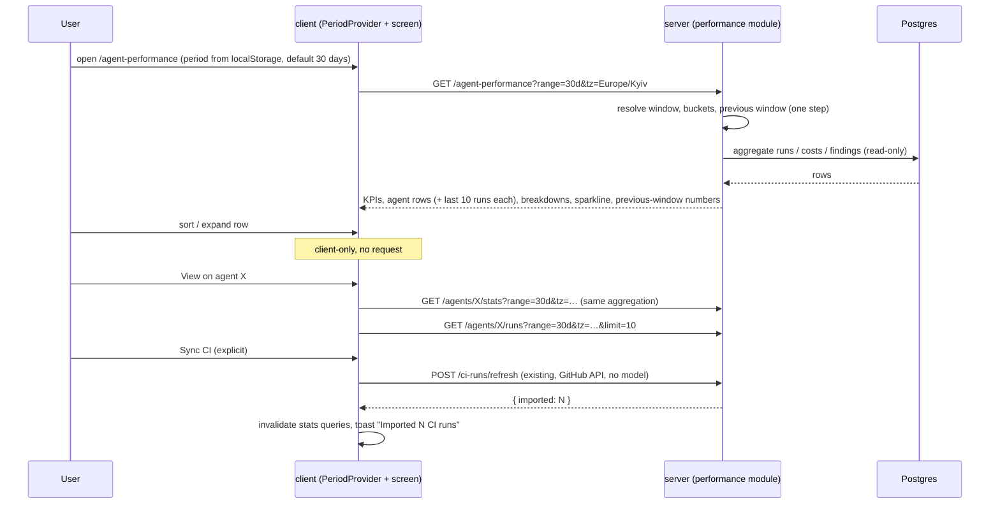
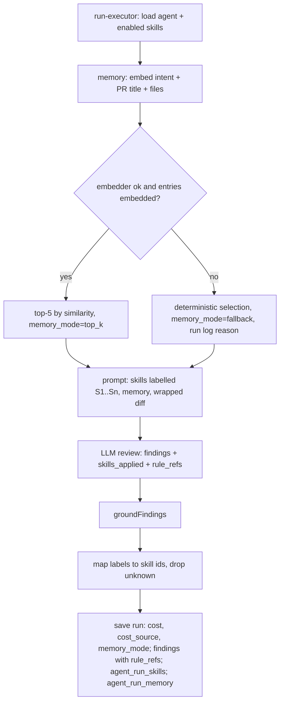

# Spec: Agent Performance dashboard + Agent Stats + Skill Stats | SPEC-2026-10-11-agent-performance-dashboard | Status: approved
Supersedes: N/A (replaces the current Skill Stats formulas in `server/src/modules/skills/repository.ts` and the all-time formula in `AgentsRepository.statsForWorkspace`, see AC-71, AC-72)
Related: [SPEC-2026-07-12-multi-agent-review](SPEC-2026-07-12-multi-agent-review.md) (multi-agent runs are counted; `RunTraceDrawer` consumer), [SPEC-2026-07-19-export-to-ci](SPEC-2026-07-19-export-to-ci.md) (source of CI runs), [SPEC-2026-07-19-memory-subsystem](SPEC-2026-07-19-memory-subsystem.md) (memory selection changes to top-K). Source of all product decisions: the user-approved plan `~/.claude/plans/proud-beaming-lake.md` (2026-10-11).

## Problem and why
DevDigest stores every agent run (`agent_runs`), its cost, duration and the findings it produced, together with accept/dismiss decisions. Nothing shows this data per period. There is no global performance screen, the Agent Editor has no Stats tab, and the Skill Editor Stats tab uses different formulas (verdict-based accept rate, findings of all agents that have the skill, pull frequency over all workspace PRs) and has no period. Several facts the mockups need are not recorded at all: which skills a run actually used, which memory entries it pulled, whether a cost is billed or estimated, and when/which CI run produced a CI row. After this work, one period-aware, read-only aggregation feeds three screens (Agent Performance, Agent Stats, Skill Stats), so the dashboard row of an agent equals that agent's Stats for the same period by construction, and the write path records the missing facts for new runs.

## Goals / Non-goals
**Goals:**
- New global screen **Agent Performance** (`/agent-performance`) in the GLOBAL sidebar section: 4 KPIs, an agent table with sorting and row expand, cost breakdown by agent and by model.
- New **Stats** tab in the Agent Editor: KPIs, most-used skills, most-pulled memory, findings by severity and by category, run history with cursor pagination and the shared `RunTraceDrawer`.
- **Skill Stats** tab rewritten to the mockup and to the shared rules (Used by, Pull frequency, Accept rate, Findings, agents using the skill, findings by category).
- One global period selector (1 day / 30 days / Custom range ≤ 30 days), shared by all three screens and persisted across reloads.
- One server-side window resolution and one aggregation used by all three screens. Read-only: no LLM, embedding or review calls on any read path.
- Honest data: denominators always visible, "small sample" marking, billed vs estimated cost marking, "no data before <date>" for facts that old runs don't have.
- Write-path changes so the facts exist for new runs: `cost_source`, run-to-skill and run-to-memory records, skill labels and `skills_applied` / `rule_refs` in the review response, top-K memory retrieval by embedding with fallback (and a per-run memory-selection mode), CI rows with real `ran_at` and a link to their CI run.
- "Sync CI" button that triggers the existing CI import on explicit click only.

**Non-goals:**
- Background / periodic CI synchronisation on the server (P2). CI import happens only on "Sync CI" click or the existing CI Runs refresh.
- A "This month" period preset (P2). A calendar month is reachable only via Custom range.
- Periods longer than 30 days, in any form.
- New Settings of any kind: thresholds (small sample 5 / 10, 1 p.p. arrow, top-K = 5, max 7 sectors) are named code constants, not settings. No changes to the API Keys, Integrations or Automatic Reviews settings pages.
- Backfilling old runs: no backfill of `cost_source`, run-to-skill, run-to-memory, `rule_refs` or `ci_run_id`. Old rows are ignored where a fact is missing (cost-source badge) or shown as "—" / "No data before <date>". No table is wiped or truncated.
- Agent icon/colour columns in the DB. Agent colour is derived deterministically from the agent id; the icon is the shared `Cpu` icon.
- Changing `AgentCard` on the Agents list (it keeps its all-time numbers; only its data source formula is unified, AC-72).
- Adding the cost of the memory embedding call (made during review) to the run cost; it is a separate task.
- Disabling any skill from the prompt based on relevance. All enabled skills still go into the prompt; only their usage is recorded.
- Denormalised/pre-computed aggregates. Everything is computed at read time.
- Accessibility requirements (out of scope for this project).

## User stories
- **US-1:** As a team lead, I want a global Agent Performance screen for 1 day, 30 days or a custom range, so I see how many runs happened, what they cost, how often findings are accepted and which agent is most active.
- **US-2:** As a team lead, I want a per-agent table I can sort and expand, with denominators and small-sample marks, so I don't draw conclusions from 3 decisions.
- **US-3:** As a team lead, I want cost broken down by agent and by model that adds up exactly to Total cost, and to see which part is billed and which is a DevDigest estimate.
- **US-4:** As an agent author, I want a Stats tab on the agent with the same numbers as its dashboard row, plus skills, memory, findings by severity/category and run history with traces, so I can tune the agent.
- **US-5:** As a skill author, I want the skill's Stats to show how many agents use it, how often it is actually applied, and the accept rate and categories of the findings it produced.
- **US-6:** As any user, I want one period selection that follows me between the three screens and survives reload, so numbers on different screens are always for the same window.
- **US-7:** As a user, I want opening, reloading, sorting and expanding these screens to never start a review or a model call, so looking at stats costs nothing.
- **US-8:** As a user with CI agents, I want to pull fresh CI runs into the stats on demand, with CI runs placed at the time they actually ran.

## Acceptance criteria (EARS)

EARS keywords: "The system shall" (ubiquitous), WHEN (event), WHILE (state), IF … THEN (unwanted), WHERE (optional feature).

### A. Navigation and the global period

- **AC-1:** The system shall show an "Agent Performance" item in the GLOBAL section of the sidebar, placed per the mockup so that the GLOBAL section order is Memory → Multi-Agent Review → Agent Performance → CI Runs (CI Runs moves to the end of the section), linking to the workspace-level route `/agent-performance` (not repo-scoped).
  `observable: component test of the sidebar (item order Memory → Multi-Agent Review → Agent Performance → CI Runs) + E2E click → /agent-performance`
- **AC-2:** The system shall offer one period selector with exactly three options — "1 day", "30 days", "Custom range" — and the same selector component on Agent Performance, Agent Stats and Skill Stats. The default, when nothing is stored, shall be "30 days".
  `observable: component test of the selector on each of the 3 screens; first visit with empty localStorage → "30 days"`
- **AC-3:** WHEN the user changes the period on any of the three screens, the system shall use that period on the other two screens without further input and shall keep it after a full page reload. IF the stored value is missing, unreadable or invalid, THEN the system shall fall back to "30 days" without an error.
  `observable: E2E — Agent Performance → 1 day → View → Agent Stats shows 1 day → switch to 30 days → back → dashboard shows 30 days → reload → still 30 days; unit — corrupted stored value → 30 days`
- **AC-4:** WHEN the period is "30 days", the system shall use the rolling window `[now − 30×24h, now)` (last bucket includes `now`), not a calendar month.
  `observable: unit of the window resolver at 2026-10-11 12:22 → from 2026-09-11 12:22`
- **AC-5:** WHEN the period is "1 day", the system shall use six fixed 4-hour slots aligned to 00, 04, 08, 12, 16, 20 in the user's local time zone, where the sixth slot is the current, incomplete slot: `from` = start of the current slot − 20 h, `to` = now. All KPIs, tables, breakdowns and charts on that screen shall use this same window.
  `observable: unit — at 12:22 → slots Oct 10 16–20, 20–24, Oct 11 00–04, 04–08, 08–12, 12–16 (data 12:00–12:22); at 07:50 → Oct 10 08–12 … Oct 11 04–08 (data 04:00–07:50); exactly 6 buckets in both`
- **AC-6:** WHEN the user picks "Custom range", the system shall let the user select a start and end date with a range of at most 30 days, and the date picker shall not allow selecting a longer range. A custom range of dates D1…D2 shall mean the window `[D1 00:00, (D2 + 1 day) 00:00)` in the user's local time zone, capped at `now` WHEN D2 is today.
  `observable: component test — selecting a 31-day range is impossible / rejected in the picker; unit — Oct 1…Oct 3 at 12:22 on Oct 3 → [Oct 1 00:00, Oct 3 12:22)`
- **AC-7:** IF a stats request carries neither a valid preset (`1d` | `30d`) nor a valid `from`/`to` pair, or `to ≤ from`, or the range exceeds 30 days, or the time zone is not a valid IANA name, THEN the server shall reply 400 and return no data.
  `observable: curl/route test — from/to 31 days apart → 400; tz=Mars/Base → 400; to<from → 400; range=7d → 400`
- **AC-8:** The system shall resolve the window, its buckets and the previous window on the server with one resolution step from (preset or from/to, time zone, now), and shall use that result for every KPI, table, breakdown and chart of all three screens.
  `observable: unit of the resolver + integration — dashboard and agent stats responses for the same request report identical window bounds`
- **AC-9:** The system shall split the window into buckets as follows: "1 day" and a 1-day custom range → 6 four-hour slots labelled H1…H6 (the same slot rule as AC-5); a custom range of 2–14 days → one bucket per local day labelled D1…Dn; a window of 15–30 days (including "30 days") → rolling 7-day buckets counted from `from` (`[from + 7i days, min(from + 7(i+1) days, to))`), `ceil(days / 7)` of them (≤ 5), labelled W1…W5, the last one possibly incomplete. Buckets are `[start, end)`; the last bucket includes `now`. Buckets with no data shall be returned with zeros.
  `observable: unit — 30d at 12:22 → W1 09-11 12:22→09-18 12:22 … W4 10-02→10-09, W5 10-09 12:22→now (2 days); 10-day custom → D1…D10; 1-day custom → H1…H6; empty buckets present with 0`
- **AC-10:** WHEN the user hovers a bucket (bar or sparkline point), the system shall show its exact local date/time range in a tooltip, and mark the last bucket "in progress" (1 day) or "partial" (weeks), e.g. "H2: Oct 10 20:00–24:00", "W5: Oct 9 12:22 – now, partial".
  `observable: component test of the chart tooltip`
- **AC-11:** The system shall not append a period suffix to any KPI title, table header or card title ("TOTAL RUNS", "TOTAL COST", "FINDINGS", "RUNS" — never "(30D)" / "30D"). The period shall be visible only in the selector and in a window caption next to it, e.g. "1 day · Oct 10 16:00 – now".
  `observable: component tests — no "30D" / "(30D)" text in the rendered screens; caption present`
- **AC-12:** The system shall define the previous window as the window of the same length that ends at the current window's `from` (1 day → previous 6 slots; 30 days → previous 30 days; custom → same length before `from`).
  `observable: unit of the resolver`

### B. Read-only guarantee

- **AC-13:** The system shall serve Agent Performance, Agent Stats, run history and Skill Stats data only from stored runs, findings and related rows, with no LLM call, no embedding call, no review run and no CI import on any of these read endpoints.
  `observable: unit — route tests with a spy on the injected LLM provider, embedder, review runner and CI service → 0 calls`
- **AC-14:** WHEN the user opens or reloads any of the three screens, changes the period, sorts the table, expands or collapses a row, scrolls the run history, opens a trace drawer or clicks View/Open, the system shall issue only GET requests and shall not start a review or a model call.
  `observable: client component tests — fetch called only with GET; no mutation hooks invoked; E2E network log contains no POST except "Sync CI" when clicked`

### C. Shared aggregation rules (all three screens)

- **AC-15:** The system shall count as runs only finished agent runs with status `done` or `failed` whose run time (`ran_at`) is inside the window, including CI runs and runs that are part of a multi-agent review. Runs with status `running` or `cancelled` shall be excluded from runs, cost, duration, findings and every other aggregate of this feature.
  `observable: integration — window with 1 done, 1 failed, 1 ci, 1 multi-agent, 1 running, 1 cancelled run → runs = 4; the running/cancelled runs' cost and findings are not counted`
- **AC-16:** The system shall compute total cost as the sum of the cost of runs in the window whose cost is known, at full precision. Runs with unknown cost shall be excluded from the sum and from the average-cost denominator, and shown as "N runs without cost" next to the cost metric WHEN N ≥ 1.
  `observable: integration — 3 runs with cost 0.10/0.20/null → total 0.30, avg 0.15, "1 run without cost"`
- **AC-17:** The system shall compute average duration only over successful runs (status `done`) and display it in seconds. WHILE there is no successful run in the window, it shall show "—".
  `observable: integration + component test`
- **AC-18:** The system shall compute accept rate as accepted / (accepted + dismissed) over the local findings of the runs in the window; unresolved findings shall not enter the denominator, and CI findings shall not enter it at all. The value shall always be shown with its fraction, e.g. "75% (30/40)", with the caption "based on N local findings". WHILE accepted + dismissed = 0, the system shall show "—" instead of a percentage.
  `observable: integration — 3 accepted, 1 dismissed, 2 unresolved, 2 CI findings → "75% (3/4)"; component test for "—"`
- **AC-19:** WHILE an accept rate is based on fewer than 5 decisions (accepted + dismissed), the system shall show a "small sample" badge next to it.
  `observable: component test with 4 and 5 decisions`
- **AC-20:** The system shall assign a finding to a window by the run time of the run that produced it. IF the finding's review has no run link, THEN the system shall use the review's agent and the review's creation time instead.
  `observable: integration — review with run_id null created inside the window counts; review linked to a run outside the window does not`
- **AC-21:** The system shall compute every per-agent value (runs, total cost, runs without cost, average cost, average duration, accept rate with fraction, last run) with one shared aggregation, so that for the same agent and the same window the Agent Performance row and the Agent Stats tab show identical values.
  `observable: integration — for 1d, 30d and a custom range, dashboard row of agent X === GET /agents/X/stats KPI values`
- **AC-22:** The system shall show next to every cost metric (Total cost, Avg cost, cost breakdown, run-history cost) a cost-source badge computed only over the runs in scope that have a recorded cost source: "billed" WHEN all of them have provider-reported cost, "estimated" WHEN all have a DevDigest estimate, "mixed" WHEN both are present. Runs without a recorded cost source (recorded before this feature) shall not take part in the badge at all; WHILE no run in scope has a recorded cost source, no badge shall be shown. There is no "unknown" badge value. The badge tooltip shall explain the difference: billed = cost reported by the provider's billing API; estimated = DevDigest estimate from token counts × price table.
  `observable: component test with api-only → billed, estimate-only → estimated, api+estimate → mixed, api+null → billed, null-only → no badge`

### D. Agent Performance — KPIs

- **AC-23:** WHILE the window contains at least one run, the system shall show four KPI cards: Total runs with a sparkline over the same buckets as the severity chart (AC-9); Total cost with the cost-source badge and "N runs without cost"; Avg accept rate; Most-active agent.
  `observable: component test with a populated fixture`
- **AC-24:** The system shall compute "Avg accept rate" as one fraction Σaccepted / Σresolved over the local findings of all agents in the window (not an average of per-agent rates), shown as e.g. "73% (111/152)" with the small-sample rule of AC-19.
  `observable: integration — agent A 9/10, agent B 1/2 → "83% (10/12)" (a mean of per-agent rates would give 70%)`
- **AC-25:** The system shall pick the Most-active agent among existing agents only (the "Deleted agents" aggregate is never eligible) as the agent with the most runs in the window; on a tie, the one with the later last run; on a further tie, the one whose name sorts first. Its caption shall read "<runs> runs · <accept>% accept" (accept omitted as "—" if no decisions).
  `observable: integration — tie on runs → later last run wins; tie on both → alphabetical; "Deleted agents" with the most runs is not picked`
- **AC-26:** The system shall show a Total cost delta versus the previous window only IF the previous window is fully covered by history (the workspace's first run is at or before the previous window's start). Otherwise it shall show no delta and the tooltip "Not enough history to compare".
  `observable: integration + component — seed starting 20 days ago, 30d → no delta + tooltip; seed starting 65 days ago → delta shown`

### E. Agent Performance — agent table

- **AC-27:** The system shall show one row per agent of the workspace, including disabled agents and agents with no runs in the window, with the columns Agent, Runs, Avg cost, Avg duration, Accept rate, Last run, View, and headers without a period suffix. WHILE the window contains runs whose agent has been deleted, the system shall add one extra row "Deleted agents" aggregating those runs by the same rules and without a View button, so that Σ(table Runs) = Total runs and Σ(table cost) = Total cost.
  `observable: integration (row count = agents count, +1 when deleted-agent runs exist; Σ Runs = Total runs) + component test of headers and the View-less "Deleted agents" row`
- **AC-28:** WHILE an agent has no runs in the window, the system shall show Runs = 0 and "—" in Avg cost, Avg duration, Accept rate and Last run for that row.
  `observable: component test`
- **AC-29:** The system shall colour the accept rate green WHEN it is ≥ 60% and with the warning colour otherwise, and show the small-sample badge per AC-19.
  `observable: component test at 59% / 60%`
- **AC-30:** The system shall show an accept-rate arrow versus the previous window: ↑ WHEN the rate rose by ≥ 1 p.p., ↓ WHEN it fell by ≥ 1 p.p., none WHEN the change is < 1 p.p.; the tooltip shall read "was 72% (36/50)". IF the previous window has no history for the agent, THEN the system shall show no arrow and the tooltip "No data for previous <period>". IF the previous window has fewer than 5 decisions, THEN the system shall show no arrow and the tooltip "Not enough decisions in previous period (N)". A partially covered previous window with ≥ 5 decisions shall still get an arrow.
  `observable: component tests for each branch + integration of the previous-window numbers`
- **AC-31:** The system shall show Last run as the latest run time of the agent inside the window in relative form ("4m ago"), with the exact local date/time in a tooltip, and "—" WHEN there is no run in the window.
  `observable: component test`
- **AC-32:** WHEN the user clicks View on a row, the system shall navigate to `/agents/:id?tab=stats` and the Stats tab shall use the current global period.
  `observable: E2E`
- **AC-33:** WHEN the user clicks the header of a numeric column (Runs, Avg cost, Avg duration, Accept rate, Last run), the system shall sort the rows by that column, toggling direction on repeated clicks, on the client without any network request. The default sort shall be Accept rate descending. WHILE sorting by Accept rate, agents with fewer than 5 decisions shall be placed below all agents with ≥ 5 decisions (keeping their small-sample badge), and agents with 0 decisions shall be placed last, in both directions. Rows with "—" in the sorted column shall be placed after rows with values.
  `observable: component test — sort order with small-sample and no-decision agents; fetch not called on header click`
- **AC-34:** WHEN the user expands a row, the system shall show a sparkline of the agent's last runs inside the selected window only (up to 10) and the caption "avg Xs · $Y", using data already present in the dashboard response, with no additional request. WHILE the agent has no runs, the expanded area shall show "No runs in this period".
  `observable: component test — expand → sparkline rendered, fetch not called; integration — runs before the window are not in the expand data`
- **AC-35:** The system shall show each agent with a colour picked deterministically from a fixed palette by the agent id (same agent → same colour on every screen and reload) and the shared `Cpu` icon.
  `observable: unit — same id → same colour; component snapshot`

### F. Agent Performance — cost breakdown

- **AC-36:** The system shall show two donuts, "By agent" and "By model", each summing the cost of runs with known cost in the window, grouped by the run's agent and by the run's own model respectively. Runs of deleted agents shall form one "Deleted agents" segment; runs with no model (e.g. CI) shall form one "Unknown model" segment.
  `observable: integration — run of a deleted agent and a CI run without model → those segments present`
- **AC-37:** The system shall guarantee Σ(by agent) = Total cost = Σ(by model), computed at full precision; rounding shall happen only for display.
  `observable: integration — fixture with costs like 0.1 + 0.2 + 0.0001 → all three sums equal before rounding`
- **AC-38:** The system shall order segments by cost descending and show at most 7 segments per donut: WHEN there are ≤ 7 groups, all are shown without "Other"; WHEN there are > 7, the 6 most expensive are shown plus a 7th segment "Other (N models)" / "Other (N agents)" with the sum of the rest, whose tooltip lists the hidden groups with their sums. The same rule applies to both donuts. Agents with $0 cost in the window shall not appear as segments.
  `observable: integration/unit — 9 models → 6 + Other, Σ segments = Total cost; component test of the Other tooltip`
- **AC-39:** The system shall render cost donuts with "$" and 2 decimals, the donut centre showing Total cost, and the cost-source badge (AC-22) above the block.
  `observable: component test`
- **AC-40:** WHILE the window has runs but no known cost (Total cost = 0 or no run has a known cost), the system shall render a grey ring with the text "No cost data in this period" instead of segments.
  `observable: component test`

### G. Agent Editor — Stats tab

- **AC-41:** The system shall add a "Stats" tab to the Agent Editor, selectable via `?tab=stats`, with the global period selector (AC-2) and, WHERE AC-66 applies, the "Sync CI" button in its header.
  `observable: component test of AgentEditor tabs + E2E deep link`
- **AC-42:** The system shall show four KPI cards for the agent in the window: Total runs with a sparkline over the same buckets as the severity chart (AC-9); Avg cost / run with the cost-source badge and "N runs without cost"; Avg duration (AC-17); Accept rate with fraction, small-sample badge and a circular score.
  `observable: component test + integration of values (AC-21)`
- **AC-43:** The system shall show an Avg cost / run delta versus the previous window only IF the previous window contains at least 5 runs of the agent with known cost; the full-history-coverage rule of AC-26 applies to Total cost only, not to Avg cost. Otherwise no delta and the tooltip "Not enough history to compare".
  `observable: component test with 4 and 5 costed runs in the previous window (5 → delta even when the previous window is only partly covered by history)`
- **AC-44:** The system shall show "Most-used skills" as one bar per skill, with % = runs of the agent in the window in which the model reported the skill as applied / runs of the agent in the window in which the skill was loaded into the prompt. Only runs for which skill usage was recorded shall count. The card shall state "No data before <date of first recorded run>" WHEN the window starts before that date.
  `observable: integration — 10 runs with the skill loaded, 7 applied → 70%; runs without records excluded`
- **AC-45:** The system shall show "Most-pulled memory" as one bar per memory entry, with % = runs of the agent in the window in which that entry was among the pulled entries / all runs of the agent in the window that have a recorded memory-selection mode (top-K or fallback), including runs that pulled 0 entries. Runs without a recorded mode (recorded before this feature) shall be excluded from the denominator, and the same "No data before <date>" rule as AC-44 shall apply.
  `observable: integration — 4 runs with mode set (one pulled 0 entries), entry M pulled in 2 → 50%; legacy run without mode excluded`
- **AC-46:** WHILE the agent has no skills attached (for Most-used skills) or no recorded memory pulls in the window (for Most-pulled memory), the system shall show an empty state inside that card instead of bars.
  `observable: component test`
- **AC-47:** The system shall show "Findings by severity" as stacked bars, one bar per bucket of the window (AC-9), stacked Critical / Warning / Suggestion with a legend and a tooltip with the counts, counting all findings of the agent's runs in the window (resolved and unresolved, local and CI), with the caption "N findings in period".
  `observable: integration of bucket counts (incl. a CI run's findings) + component test of StackedBar`
- **AC-48:** The system shall show "Findings by category" as a donut that always lists all five categories in the fixed order security, bug, perf, style, test, each with an integer count and its share ("security 48 · 48%"), without any currency sign, with fixed colours per category (security = critical colour, bug = warning colour, perf = #8b5cf6, style = accent, test = ok colour) shared with Skill Stats. The centre shall show the total number of findings; a "small sample" badge shall appear WHEN the total is < 10.
  `observable: component test — legend order, no "$", colours, centre total`
- **AC-49:** WHILE a category has 0 findings and at least one other category has findings, the system shall still draw that category as a thin visible slice in its colour, while its legend and tooltip show the real value 0 ("style 0 · 0%").
  `observable: component test — sector for the 0 category is rendered`
- **AC-50:** WHILE all five categories have 0 findings in the window, the system shall render a grey ring, a legend of zeros, and "No findings in this period" in the centre (not an empty state replacing the card).
  `observable: component test`
- **AC-51:** The system shall show "Run history" with the columns Timestamp (local time), PR (#number linking to the PR), Tokens (in + out, abbreviated, e.g. "16k"), Cost (with cost-source badge), Findings, Source (local / CI) and View trace. Failed runs shall show a status icon with the error text in a tooltip. Values that do not exist for a row (e.g. tokens of a CI run, PR of an old CI run) shall show "—".
  `observable: component test with local, failed, CI-linked and old-CI rows`
- **AC-52:** The system shall load the run history for the window newest first, 10 rows initially, and WHEN the 5th row from the end of the loaded rows becomes visible in the scroll container, load the next page. Pages shall be cursor-based on (run time desc, id desc) so that runs created meanwhile neither duplicate nor skip rows. IF the requested page size exceeds 50, THEN the server shall reply 400.
  `observable: integration — insert a newer run between page 1 and page 2 → no duplicate/skip; curl limit=51 → 400; component test with IntersectionObserver mock`
- **AC-53:** WHEN the user clicks View trace on a local run that has a stored trace, the system shall open the same right-side run trace drawer used on the PR page and in Multi-Agent Review, populated read-only from the stored trace; the run's findings for the drawer shall be loaded by a separate GET by run id WHEN the drawer opens (the run-history list does not carry findings). WHEN the row is a CI run linked to its CI run, the system shall instead show an "Open in GitHub" link to that CI run. WHILE a row has neither, View trace shall not be offered.
  `observable: component test — drawer opens for local row and issues one GET for the run's findings; GitHub link for CI row; nothing for old CI row`

### H. Skill Editor — Stats tab

- **AC-54:** The system shall show "Used by" as the number of agents that currently have the skill attached, independent of the period, with the caption "N ran in period" = number of those agents that have at least one run in the window with the skill loaded.
  `observable: integration — changing the period changes the caption, not the number`
- **AC-55:** The system shall show "Pull frequency" for the window as PRs with at least one run in which this skill was applied / PRs with at least one run in which this skill was loaded, with its fraction, e.g. "71% (12/17 PRs)", counting local runs only (CI runs carry no skill data), with the caption "local runs" under the card.
  `observable: integration — CI runs on other PRs do not change the fraction; component test of the caption`
- **AC-56:** The system shall show the skill's "Accept rate" over only the findings attributed to this skill in the window (findings whose rule references contain the skill), local only, with fraction and the small-sample rule of AC-19.
  `observable: integration — findings of the agent not citing the skill do not affect it`
- **AC-57:** The system shall show "Findings" (title without period suffix) as the number of findings in the window attributed to this skill, and a "Findings by category" donut over the same findings with the rendering rules of AC-48…AC-50; the donut centre shall equal the Findings card value. A finding citing several skills shall count for each of them; a finding with no rule references shall count for none.
  `observable: integration — 1 finding citing S1+S2 → counted in both skills; component test centre = card`
- **AC-58:** The system shall show "Agents using this skill" as the list of agents that currently have the skill attached, sorted by name, independent of the period; each row shows the agent's icon and name and an "Open" button that navigates to `/agents/:id?tab=stats` with the current global period. Disabled agents shall render muted with a "disabled" badge.
  `observable: component test + E2E`
- **AC-59:** WHILE the skill is attached to no agent, the system shall show the "No usage yet" empty state on the Skill Stats tab.
  `observable: component test`

### I. Empty, loading and error states

- **AC-60:** WHILE the workspace has never had any agent run, the system shall replace the whole Agent Performance content with an empty state: icon Activity, title "No agent runs yet", text "Agent Performance fills in automatically after agents review pull requests — locally or in CI. Nothing is collected until the first run.", text only — no button and no link.
  `observable: component test with an empty workspace — no button/anchor inside the empty state`
- **AC-61:** WHILE the workspace has runs but none in the selected window, the system shall keep the page header and the period selector and replace KPIs, table and donuts with one empty state "No runs in the last <period>" / "Try a longer period", text only — no button and no link.
  `observable: component test — selector still interactive`
- **AC-62:** The system shall render the states "agent without runs in the window" (a table row per AC-28) and "dashboard with no runs at all" (AC-60) / "no runs in the window" (AC-61) differently, so that each is distinguishable in a test.
  `observable: component tests asserting three different DOM outputs`
- **AC-63:** WHILE the agent has never run, the Agent Stats tab shall show "This agent hasn't run yet"; WHILE the agent has runs but none in the window, it shall keep the period selector and show "No runs in this period". The Skill Stats tab shall apply the same two states for runs with the skill loaded, in addition to AC-59. All these empty states are text only, with no button and no link.
  `observable: component tests`
- **AC-64:** WHILE data for a screen or card is loading, the system shall show skeletons and no numbers, zeros or "—".
  `observable: component test — pending query → no digit text and no "0" in KPI cards`
- **AC-65:** IF a stats request fails, THEN the system shall show an error state with a Retry action and no numbers or zeros; Retry shall repeat only the failed GET.
  `observable: component test — fetch → 500 → error state, no "0"; Retry → one GET`

### J. Sync CI

- **AC-66:** WHERE the workspace has at least one CI installation, the system shall show a "Sync CI" button next to the period selector on Agent Performance and on Agent Stats; otherwise it shall not show the button.
  `observable: component test with and without installations`
- **AC-67:** WHEN the user clicks "Sync CI", the system shall call the existing CI import (the same action as the CI Runs refresh), disable the button until it finishes, then refresh all stats data on screen and show the toast "Imported N CI runs". IF the import fails, THEN the system shall show an error toast and keep the previously shown data.
  `observable: component test — click → one POST to the CI refresh endpoint, stats queries invalidated, toast; error path`

### K. CI rows

- **AC-68:** WHEN the CI import creates an agent run for a CI run, the system shall set the run time to the CI run's own run time (not the import time) and link the agent run to that CI run.
  `observable: integration of the CI ingest — ran_at = ci_runs.ran_at; ci_run_id set`
- **AC-69:** The system shall include findings of CI runs linked to an agent run in findings by severity and by category (AC-47, AC-48) and shall exclude them from every accept rate.
  `observable: integration`
- **AC-70:** IF a CI agent run has no model, tokens or cost source, THEN the system shall show it under "Unknown model" in the model breakdown, "—" for tokens and no cost-source badge contribution (AC-22); IF it has no link to a CI run (created before this change), THEN PR and GitHub link shall show "—".
  `observable: integration + component test`

### L. Replaced formulas

- **AC-71:** The system shall compute Skill Stats only with the definitions of AC-54…AC-57. The previous definitions (verdict-based accept rate, findings of all agents having the skill, pull frequency over all workspace PRs without a period) shall be removed from the server, not kept alongside.
  `observable: integration tests of GET /skills/:id/stats updated; grep shows the old formula code is gone`
- **AC-72:** The system shall compute the all-time agent numbers used by the Agents list with the same shared aggregation (AC-21) without a window, and remove the separate old formula; the Agents list UI shall not change.
  `observable: agents-stats integration test updated and passing; AgentCard component tests unchanged`

### M. Write path (new runs)

- **AC-73:** WHEN a review run completes with a cost, the system shall record the cost source with the run: "api" WHEN the provider reported the cost, "estimate" WHEN the cost was computed from tokens and a price table (always the case for the direct Anthropic and OpenAI adapters); WHEN the cost is unknown, the source shall be empty.
  `observable: unit of the provider adapters (OpenRouter usage.cost present → api, absent → estimate; Anthropic/OpenAI → estimate) + integration of the run row`
- **AC-74:** WHEN the review prompt is assembled, the system shall give each included skill a short label `[S1]…[Sn]`, and the review response schema shall allow a review-level list of applied skill labels and an optional per-finding list of rule labels that produced the finding.
  `observable: reviewer-core unit with stub LLM — prompt contains [S1]…[Sn] in order; schema accepts both fields and accepts their absence`
- **AC-75:** WHEN a review response is saved, the system shall map skill labels to skill ids for this run and discard labels that do not correspond to a skill of the run; IF the response omits the applied list, THEN every loaded skill shall be recorded as not applied; IF a finding omits rule labels, THEN the finding shall be saved without rule references.
  `observable: unit — labels "S1","S9" with 3 skills → only S1 kept; missing fields → applied=false / null`
- **AC-76:** WHEN a review run completes, the system shall record for the run every skill that was loaded into the prompt, with the skill version, whether it was applied, and how many saved findings cited it.
  `observable: integration — 3 loaded skills, 1 applied, 2 findings citing it → 3 records with correct flags/counts`
- **AC-77:** WHEN a review run selects memory for the prompt, the system shall rank the eligible memory entries (same scope and confidence filter as today: repo + global, confidence ≥ 0.7) by embedding similarity to a query built from the PR intent (always available: the first agent run on a PR computes it), the PR title and the list of changed files, consider only eligible entries that have an embedding (entries without one are not eligible in top-K mode), take the top 5, record for the run the memory-selection mode "top-K", and record each selected entry with its rank and similarity. A run that selects 0 entries shall still record its mode.
  `observable: unit with a stub embedder — 8 eligible entries → 5 selected in similarity order; records written with rank 1..5, mode top-K; 0 eligible entries → mode recorded, no entry records`
- **AC-78:** IF and only IF the embedder is unavailable or fails, or no eligible entry has an embedding, THEN the system shall fall back to the current deterministic memory selection, write the reason to the run log, record the memory-selection mode "fallback" for the run and the selected entries with an empty similarity, and continue the review without failing it.
  `observable: unit — embedder throws → fallback selection used, run log line present, mode = fallback, run status done`
- **AC-79:** The system shall keep the reviewer-core invariants: diff and PR text stay wrapped as untrusted, and every finding passes grounding before it is saved; rule references are kept only on findings that survived grounding.
  `observable: reviewer-core tests — existing grounding/wrapping tests still pass; a dropped finding's rule labels do not reach findings_cited`
- **AC-80:** WHEN a run's data predates tracking of skills, memory, rule references, cost source or CI link, the system shall leave such runs out of the affected metric (cost-source badge, Most-used skills, Most-pulled memory, skill attribution) or show "—" / "No data before <date>", and shall not infer or backfill them, nor delete or truncate any existing data.
  `observable: integration with legacy rows (null cost_source / memory mode, no records) → excluded from the affected metrics; row counts of existing tables unchanged after migration`

### N. Database, seed, settings

- **AC-81:** The system shall introduce all schema changes of this feature in exactly one generated migration (see Data model), applied explicitly, never on boot.
  `observable: git diff shows one new migration file + snapshot; server boots without running it`
- **AC-82:** WHEN demo data is seeded, the system shall create runs spread over at least 35 days (so previous-window deltas exist), a mix of billed / estimated cost plus legacy runs without cost source, cancelled runs, runs of a deleted agent, failed runs, CI runs linked to CI runs with CI findings, one agent without runs, skill and memory usage records (with memory-selection mode, including runs with 0 pulled entries) with an uneven spread (e.g. 92 / 88 / 71 / 34 / 22 %), and findings with accept/dismiss decisions and rule references. Seeding shall not create `running` runs (they would show as permanently in progress); exclusion of `running` is verified by integration tests (AC-15). All seeded memory entries shall have embeddings. Seeding shall stay idempotent.
  `observable: pnpm db:seed twice → no duplicates; manual check of /agent-performance`
- **AC-83:** The system shall not add any new Settings page, field or option for this feature.
  `observable: git diff shows no changes under the Settings UI and settings routes`

## Deviations from the mockup (intentional, user-approved)
- No period suffix anywhere: "TOTAL RUNS", "TOTAL COST", "FINDINGS", column "RUNS" instead of "(30D)" / "RUNS 30D" (AC-11).
- Category donut shows counts without "$" (the mockup shows "$48.00" because of the Donut default currency prefix) (AC-48).
- The category donut always shows all 5 categories, zero ones as thin slices with a real 0 in the legend (AC-48, AC-49).
- Severity bars: at most 5 weekly bars W1…W5 counted from the period start (the mockup hard-codes w1…w6) (AC-9).
- Agent icons/colours: deterministic palette colour by id + shared `Cpu` icon instead of the mockup's hard-coded per-agent icons (AC-35).
- Period selector on the Skill Stats tab and the "Sync CI" button are additions not present in the mockups.

## Traceability to the original task (verbatim requirements)
| Requirement (UA, verbatim) | ACs |
|---|---|
| додати Agent Performance до Global sidebar; підтримати 1 day, 30 days і custom range | AC-1…AC-12 |
| показати Total runs, Total cost, Avg accept rate і Most-active agent | AC-23…AC-26 |
| таблиця Agent, Runs, Avg cost, Avg duration, Accept rate, Last run і View | AC-27…AC-35 |
| cost breakdown за agents і models; ті самі API та aggregation rules, що й вкладка Stats | AC-36…AC-40, AC-8, AC-21 |
| loading, empty та error states; не запускати model calls — dashboard читає лише збережені runs і findings | AC-60…AC-65, AC-13, AC-14, AC-53 |
| показувати знаменник accept rate та кількість runs у вибраному періоді | AC-15, AC-18, AC-24, AC-27 |
| сортування за accept rate лише для агентів із достатньою кількістю рішень або чітко позначати малу вибірку | AC-19, AC-33 |
| runs, cost, duration та accept rate збігаються зі Stats того самого агента за той самий період | AC-21, AC-3, AC-8, AC-15 |
| Total cost = сума врахованих запусків, breakdown за agents і models сходиться з total | AC-15, AC-16, AC-27, AC-37, AC-38 |
| Most-active agent за кількістю runs у періоді | AC-25 |
| agent без запусків і повністю порожній dashboard мають різні коректні states | AC-28, AC-60…AC-62 |
| loading та error не показують вигаданих нулів | AC-64, AC-65 |
| перезавантаження, сортування й розгортання рядка не запускають review або model call | AC-13, AC-14, AC-33, AC-34 |
| у cost metrics зрозуміло, де оцінка DevDigest, а де звірені billing data | AC-22, AC-73, AC-80 |

## Edge cases
- **Exactly 1 day / 30 days of custom range** → allowed; a 1-day custom range uses H1…H6 slots (AC-9); 30 days + 1 minute → 400 (AC-7).
- **Custom range ending today** → window capped at `now` (AC-6).
- **Running or cancelled runs in the window** → excluded from every aggregate (AC-15).
- **Only legacy runs (no cost source) in the window** → no cost-source badge; cost totals still count their cost (AC-16, AC-22).
- **Run that pulled 0 memory entries** → counts in the Most-pulled memory denominator via its recorded mode (AC-45, AC-77).
- **Time-zone with DST change inside the 1-day window** → slots stay aligned to local wall-clock 00/04/…/20; one slot may be 3 h or 5 h long. `[accepted risk]`
- **Run at the exact bucket boundary** → belongs to the later bucket (`[start, end)`, AC-9).
- **Window of 1 day at 00:05** → the last slot H6 holds 5 minutes of data, marked "in progress" (AC-10).
- **Agent deleted** → its runs count in Total runs / Total cost, in the "Deleted agents" cost segment and in the "Deleted agents" table row (no View) (AC-27, AC-36).
- **All runs have unknown cost** → grey ring "No cost data in this period", "N runs without cost" (AC-16, AC-40).
- **> 7 agents or models with cost** → 6 + "Other (N …)" (AC-38).
- **Agent with runs only in the previous window** → row with Runs 0 and "—"; no arrow (no decisions in current window).
- **Previous window partly before the first run** → accept arrow if ≥ 5 decisions there, no cost delta (AC-26, AC-30, AC-43).
- **Findings resolved after the window ends** → still count, because assignment is by run time, not decision time (AC-20). `[accepted risk: accept rate of an old window can still move when old findings are resolved later]`
- **Review without run link** → assigned by review agent + creation time (AC-20).
- **CI findings** → in severity/category charts, never in accept rate (AC-69).
- **Model returns unknown or malformed skill labels** → discarded (AC-75).
- **Finding dropped by grounding** → its rule labels are not counted (AC-79).
- **Skill detached from an agent mid-window** → Used by (current config) drops; "N ran in period" and Pull frequency still count runs where it was loaded (AC-54, AC-55).
- **Skill version changed mid-window** → stats aggregate across versions; the version is recorded per run for later use. `[accepted risk: no per-version split in this spec]`
- **Some eligible memory entries lack an embedding** → top-K mode is kept; those entries are not eligible and are skipped (AC-77).
- **Embedder down or no eligible entry has an embedding** → fallback selection, mode "fallback" recorded, run continues, run log line (AC-78).
- **Memory entry deleted** → its run-memory records go with it; it disappears from Most-pulled memory.
- **New runs arrive while scrolling run history** → cursor pagination prevents duplicates/skips; new rows appear only after refetch (AC-52).
- **Sync CI pressed twice** → button disabled while running (AC-67).
- **Stored period value malformed, or a stored custom range longer than 30 days** → falls back to 30 days (AC-3). A valid past custom range (e.g. Sep 1–10) is kept as is.
- **Many agents (e.g. 50+)** → table renders all rows; no pagination in this spec. `[accepted risk]`

## Data model / Schema
One Drizzle migration (`pnpm db:generate` → `pnpm db:migrate`):

- **agent_runs** (existing) + `cost_source` (nullable: `api` | `estimate`; null = recorded before this feature, ignored by the badge) + `memory_mode` (nullable: `top_k` | `fallback`; null = recorded before this feature, excluded from the Most-pulled memory denominator) + `ci_run_id` (nullable, references `ci_runs`, set null on delete).
- **agent_run_skills** (new): run_id (→ agent_runs, cascade), skill_id (→ skills, cascade), skill_version, applied (bool), findings_cited (int). Primary key (run_id, skill_id).
- **agent_run_memory** (new): run_id (→ agent_runs, cascade), memory_id (→ memory, cascade), rank (int), similarity (nullable double; null when fallback selection was used). Primary key (run_id, memory_id).
- **findings** (existing) + `rule_refs` (nullable list of skill ids; null for old findings and findings without labels).
- **Indexes:** agent_runs (workspace_id, ran_at), agent_runs (agent_id, ran_at), reviews (run_id).
- No denormalised aggregates. No backfill. No existing data is deleted or truncated.

Derived (not persisted): window `{from, to, tz, buckets[{label, start, end, partial}], previous{from, to}}`.

## Workflows

### Read path (all three screens)

### Write path (review run)

## Service communication
- client (Agent Performance) → `GET /agent-performance` → server performance module → Postgres (read-only).
- client (Agent Stats) → `GET /agents/:id/stats`, `GET /agents/:id/runs` → server performance module → Postgres (read-only).
- client (Skill Stats) → `GET /skills/:id/stats` (rewritten) → shared aggregation → Postgres (read-only).
- client (run trace drawer) → `GET /runs/:id/trace` (existing, read-only) + `GET /runs/:id/findings` (new, read-only) when the drawer opens.
- client ("Sync CI") → `POST /ci-runs/refresh` (existing) → server ci module → GitHub API → inserts CI agent runs with `ran_at` + `ci_run_id`.
- client (Sync CI visibility) → existing CI installations data (read-only).
- server reviews run pipeline → embedder (OpenAI, existing adapter) during review only → reviewer-core prompt/schema → LLM provider (existing single review call).

## Contracts (high-level)
All read endpoints accept either `range=1d|30d` or `from&to` (ISO, ≤ 30 days), plus `tz` (IANA). Invalid → 400 (AC-7).

- `GET /agent-performance` → `200 { window, hasAnyRuns, kpis: { totalRuns, sparkline[], totalCost, costSource (billed|estimated|mixed|null), runsWithoutCost, costDelta|null, acceptRate{accepted,resolved}, mostActive{agentId,name,runs,acceptRate}|null }, agents: [{ id|null (null = "Deleted agents" row), name, enabled, runs, avgCost, avgDurationMs, accept{accepted,resolved}, previousAccept{accepted,resolved}|null, previousCovered, lastRunAt, recentRuns[≤10] }], costByAgent[≤7], costByModel[≤7] }`
- `GET /agents/:id/stats` → `200 { window, hasAnyRuns, kpis (same shape as one agent row + sparkline, costDelta), skills[{ skillId, name, applied, loaded }], memory[{ memoryId, preview, pulled, tracked }], trackingSince, severityBuckets[{ label, start, end, partial, critical, warning, suggestion }], categories[5 × { category, count }] }`
- `GET /agents/:id/runs?…&limit≤50&cursor=` → `200 { items: [{ id, ranAt, status, error, pr{number,url}|null, tokensIn, tokensOut, costUsd, costSource, findingsCount, source, hasTrace, ciRunUrl|null }], nextCursor|null }`
- `GET /skills/:id/stats?…` → `200 { window, usedBy, ranInPeriod, pullFrequency{prsApplied, prsLoaded}, accept{accepted,resolved}, findings, categories[5], agents[{ id, name, enabled }] }`
- `GET /runs/:id/findings` → `200 { items: FindingRecord[] }` — findings of one run for the trace drawer, loaded when the drawer opens; run of another workspace → 404.
- `POST /ci-runs/refresh` — unchanged, new consumer.
- Review response schema (reviewer-core): + `skills_applied?: string[]` (labels) at review level, + `rule_refs?: string[]` (labels) per finding.
Exact field names are for the plan; contracts live in `server/src/vendor/shared/contracts/`.

## Non-functional
- **Perf:** Each read endpoint shall use a fixed number of queries independent of the number of agents (no per-agent query loop).
- **Perf:** Sorting and expanding rows shall cause 0 network requests (AC-33, AC-34).
- **Reliability:** IF the embedder fails during a review, the review shall complete (AC-78).
- **Security:** `tz`, `from`, `to`, `range`, `limit` and `cursor` shall be validated by schema on the server; an invalid or tampered cursor → 400, never a raw SQL error.
- **Security:** all stats endpoints shall return only data of the caller's workspace; an agent/skill id of another workspace → 404.

## Inputs (provenance)
- Window/buckets (AC-4…AC-12): `[deterministic: server window resolver]` from preset/from-to, tz, now.
- KPIs, table, breakdowns, severity, category, run history (AC-15…AC-57): `[deterministic: Postgres]` agent_runs, findings, reviews, ci_runs, ci_run_findings, run_traces, agent_run_skills, agent_run_memory.
- Sync CI (AC-67): `[deterministic: GitHub API via existing CI import]`.
- Skill applied / rule refs (AC-74, AC-75): `[reused: the existing single review LLM call]`, extra fields in its response — no new LLM call.
- Memory ranking (AC-77): `[new: 1 embedding call per review run]`, during the review only, never on a stats read.
- Cost source (AC-73): `[deterministic: provider response / price table]`.

## Untrusted inputs
- **Model output `skills_applied` / `rule_refs`**: treated as data; only labels that map to a skill loaded in this run are kept (AC-75); never used as ids directly.
- **Skill bodies, memory content, PR title, changed file names**: user/third-party text. Skill bodies and memory continue to go through the existing prompt assembly; the diff and PR body stay wrapped by `wrapUntrusted()`; `groundFindings()` stays mandatory before saving (AC-79). The embedding query text is sent only to the embedder, not executed or interpreted.
- **Query parameters (`tz`, dates, cursor, limit)**: validated by schema (Non-functional → Security).
- **Agent/skill/memory names and error texts displayed in tables/tooltips**: rendered as plain text by React, no raw HTML.

## Verification hints
- AC-4…AC-12 → unit tests of the window resolver at 12:22 and 07:50, 30d → 5 weeks (last 2 days), custom > 30 days → 400, tz boundaries.
- AC-13, AC-14 → route tests with spies on the injected LLM provider / embedder / CI service; client tests asserting only GET fetches and no mutation calls on sort/expand.
- AC-15…AC-26, AC-36…AC-38 → `*.it.test.ts` for the performance repository: Σ by agent = total = Σ by model; dashboard row = `/agents/:id/stats` for 1d / 30d / custom; boundaries; null cost and failed; most-active tie; > 7 models → 6 + Other.
- AC-27…AC-35, AC-60…AC-65 → client component tests (vitest + RTL): loading/error without zeros; empty dashboard vs agent without runs; sort with small sample; expand without fetch.
- AC-44…AC-57, AC-71 → integration tests for agent and skill stats with seeded run-skill / run-memory records and rule references; updated `agents-stats.it.test.ts` and skill stats tests.
- AC-68 → CI ingest test: `ran_at` = CI run time, `ci_run_id` set.
- AC-73…AC-79 → reviewer-core tests with stub LLM (labels in prompt, schema with/without new fields, unknown labels dropped); server unit for top-K memory with stub embedder and fallback.
- Manual: `./scripts/dev.sh` → compare an agent's row on `/agent-performance` with its Stats for 30d and a custom range; select a period without runs (AC-61); stop the API (AC-65).

## Open questions
None. All 15 questions from the first draft were resolved by the user on 2026-10-11 (see Resolved decisions).

## Resolved decisions (2026-10-11, from user answers)
- **Sidebar order** follows the mockup: Memory → Multi-Agent Review → Agent Performance → CI Runs (AC-1).
- **Run statuses:** only `done` and `failed` count; `running` / `cancelled` are excluded from all aggregates (AC-15).
- **Avg cost delta:** ≥ 5 costed runs in the previous window; the full-coverage rule is for Total cost only (AC-26, AC-43).
- **Most-pulled memory denominator:** all runs with a recorded memory-selection mode, including 0-entry runs; new `agent_runs.memory_mode` (AC-45, AC-77, AC-78).
- **Deleted agents:** an extra "Deleted agents" table row without View, so table sums equal the KPIs (AC-27).
- **Custom range:** `[D1 00:00, (D2+1) 00:00)` local, capped at now; a 1-day custom range uses H1…H6; the sparkline uses the severity-chart buckets (AC-6, AC-9, AC-23, AC-42).
- **Row expand:** last 10 runs inside the window only (AC-34).
- **Cost-source badge:** only runs with a recorded source take part; values billed / estimated / mixed; no "unknown" (AC-22). Old data is ignored, not deleted.
- **Direct Anthropic/OpenAI adapters:** `estimate` (AC-73).
- **Embedding cost:** not added to run cost; separate task (Non-goals).
- **Intent:** always available for the memory query; the only fallback is embedder unavailable / missing embeddings (AC-77, AC-78).
- **Pull frequency and skill Findings:** local only; Pull frequency caption "local runs" (AC-55, AC-57).
- **Empty states:** text only, no button and no link (AC-60, AC-61, AC-63).
- **Trace drawer findings:** separate `GET /runs/:id/findings` when the drawer opens (AC-53, Contracts).
- **No latency target** in this spec.
